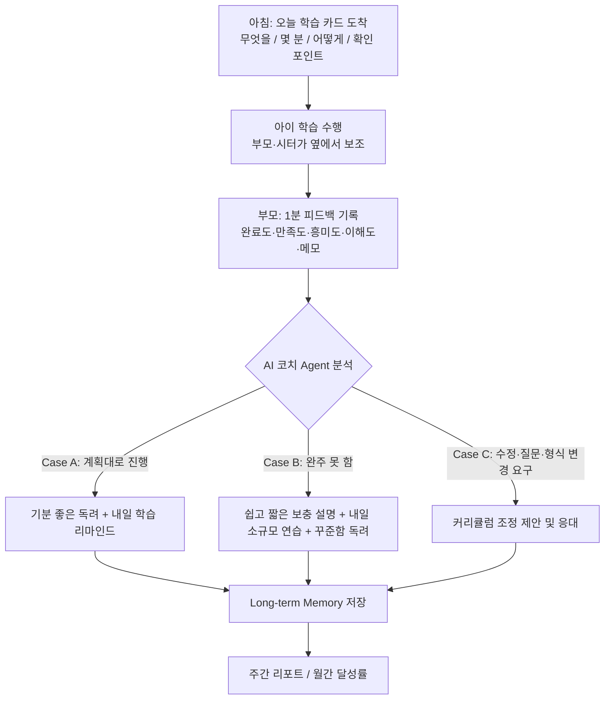

# 서비스 기획서: "꽃피다" (Bloomy)
**AI가 매일 코칭하는, 4~7세 집에서의 영어 자율 학습 구독 서비스** (가제)

| 항목 | 내용 |
|------|------|
| 버전 | v0.3 (핵심 취지 '확신 부여' 반영) |
| 날짜 | 2026-11-14 |
| 상태 | 기획 중 |
| 팀 | 3인 (14절) |

## 1. 한 줄 정의와 서비스 개요

**한 줄 정의**: 영어유치원에 보내는 비용의 상당 부분은 **부모가 해야 할 커리큘럼 설계·매일의 판단·꾸준함 유지라는 노동을 외주화한 값**이다. **Bloomy(꽃피다)**는 그 노동을 AI가 매일 대신 지는 구독형 영어 학습 코칭 서비스다.

아이는 학습하고, 부모(또는 시터)는 그날의 반응을 1분으로 기록하고, AI는 내일 무엇을 어떻게 할지 매일 구체적으로 알려준다.

**서비스 요약**:

- **교육 자체를 제공하지 않는다**: 영유아 영어 교육 분야에서 신뢰받는 콘텐츠를 **나이(4/5/6/7세)와 언어 발달 단계별로 큐레이션**해 추천함 (교재는 부모가 직접 구입, 유튜브·온라인 콘텐츠는 링크 제공)
- **가장 중요한 취지 — 확신 부여**: 좋은 콘텐츠는 이미 여기저기 널려 있다. 부족한 것은 부모의 "이것이 옳은 길이라는 확신"이다. 서비스를 책임지는 쪽이 그 확신을 부여하는 것이 이 서비스의 핵심 가치 (3절)
- **핵심 AI 기능 ① — 커리큘럼 추천 (RAG)**: 아이의 나이(4/5/6/7세) 또는 학습자가 원하는 목표에 맞춰, 큐레이션 카탈로그와 발달 단계 지식을 검색해 **알맞은 영어 학습 커리큘럼과 학습 방법**을 제공한다
- **핵심 AI 기능 ② — AI 코치 Agent**: 부모가 남기는 일일 학습 피드백을 기반으로 **계속적인 학습 독려, 학습 계획 수정, 현재 계획에 따른 내일 학습 리마인드, 현재 공부 방법에 대한 조언**을 한다
- **철학**: 아이는 스스로 배우고, 부모는 보조하고 기록한다. 영어는 증서가 아니라 "한국어처럼 영어로 사고하는 사람"이 되기 위해 배운다
- **비즈니스 모델**: 월 30만 원 구독, 목표 달성 시 10만 원까지 인하 — "꾸준한 자율 학습"을 보상하는 구조

### 미션 필수 기술 요소 반영 (2개 이상 필수 → 4개 충족)

| 기술 요소 | 본 서비스에서의 적용 |
|-----------|---------------------|
| **RAG** | 핵심 AI ①: 나이별(4/5/6/7)·목표별 커리큘럼/학습 방법 추천 — 콘텐츠 카탈로그, 전문가 해설 노트, 발달 단계 가이드를 검색해 근거로 활용 |
| **AI Agent** | 핵심 AI ②: 코치 Agent가 일일 피드백을 분석하고 도구(카탈로그 조회·이력 조회·계획 조정)를 호출해 분기(독려/보충/조정)를 판단, 내일 계획 생성 |
| **Long-term Memory** | 아이별 학습 이력, 이해도·흥미도 추이, 실패 지점, 선호 소재를 저장·활용 |
| **자동화 워크플로우** | 매일 학습 카드 발송, 미기록 리마인더, 주간 리포트, 월간 결산 — 사람 개입 없이 루프가 도는 파이프라인 |
| 멀티모달 (v2 확장) | 아이 발화 녹음의 유창성·발음 피드백 (v1 범위 제외) |

## 2. 문제 정의

### 2.1 왜 지금인가

- 맞벌이 가구의 절대 소득은 부족하지 않지만 대출·생활비로 나가는 고정 지출이 커, **줄일 수 있는 항목이 아이 교육비로 좁혀진다**
- 교육비 중 가장 큰 축인 영어유치원 비용(월 30만~100만 원+)은 **양질의 서비스 값이라기보다 시간과 노력을 외주화한 용역 값**의 성격이 강하다
- 즉 "코칭"(콘텐츠 선정 → 매일 진도 체크 → 수준 조정 → 독려)은 "교육 제공"과 분리해서 저비용으로 대체할 수 있는 부분이다

### 2.2 부모가 실제로 막히는 지점

| 막히는 지점 | 현재의 대응 | 한계 |
| --- | --- | --- |
| 무엇을, 어떤 순서로, 얼마나 시켜야 하는가 | 학원·유치원 커리큘럼에 위임 | 집에서의 복습과 연계가 끊김 |
| 우리 아이가 지금 어느 단계인가 | 감으로 판단 | 과하거나 모자란 난이도가 반복됨 |
| 오늘 학습이 잘 된 건가 | 아이 표정과 기분으로 추정 | 기록이 남지 않아 추세를 못 봄 |
| 방향이 맞는 건지 판단 못 함 | 감과 타인 가구 비교에 의존 | 의심이 지속력을 갉아먹고 "이것도 바꿔보고, 저것도 바꿔보는" 루프가 시작됨 |
| 매일 꾸준히 시키기 | 부모의 의지력에 의존 | 부모가 지치면 학습이 먼저 끊김 |
| 영어를 왜 하는가 | "초등 대비" 같은 단기 목표 | 아이도 부모도 동기가 약해짐 |

### 2.3 기존 대안의 한계

- **영어 학원·유치원**: 커리큘럼은 있으나 집에서의 매일 루프가 없고, 비용이 고정적이며, 아이 개별 반응에 대한 피드백이 오지 않는다
- **학습 앱**: 아이를 붙잡아 두는 데는 강하지만 "오늘 이 아이에게 무엇이 필요한가"를 부모 언어로 설명해주지 않는다
- **범용 챗봇**: 무엇이든 답하지만 아이의 누적 이력을 기억하지 못하고, 매일 먼저 찾아와 주지 않는다

**빈 자리**: 좋은 콘텐츠는 이미 여기저기 널려 있다. 없는 것은 아이의 어제를 기억하고, 오늘 부모가 남긴 한 줄을 읽고, **"우리는 옳은 길로 가고 있다"는 확신을 부여하면서** 내일의 한 걸음을 정확히 알려주는 코치다.

## 3. 서비스 철학 (전 제품에 관통하는 테마)

> "영어를 배우는 이유는 '특정 과정을 거쳤다는' 증서를 갖기 위한 것이 아니다.
> 읽고, 듣고, 말하고, 쓰듯 — **한국어처럼 영어로 사고할 수 있는 사람**이 되기 위해서다."

1. **확신이 가장 중요한 상품이다** — 좋은 콘텐츠는 잃어버린 핸드폰이나 자동차 키처럼 이미 여기저기 널려 있다. 마지막에 "마지막으로 어디서 썼고, 언제까지 몸에 지니고 있었는지"가 떠오르면(확신) 찾기는 쉬워진다. 교육도 마찬가지다. 부족한 것은 콘텐츠가 아니라 **"이것이 옳은 길이라는 확신"**이다. 이 서비스의 가장 중요한 취지는, 서비스를 담당하는 책임자가 부모에게 그 확신을 부여하는 것 — **방향은 맞고, 그걸 볼 수 있다**는 확신
   - 확신이 만들어지는 곳: ① 전문가 검수를 거친 큐레이션 카탈로그 ② 콘텐츠명을 인용해 근거를 보여주는 코칭 ③ 아이의 축적이 추세로 보이는 기록 ④ 매일 흔들리지 않는 일관된 철학
   - 터치포인트: 온보딩 취지 안내, 학습 방법 설명의 "왜 이 순서인지", 코칭·주간 리포트의 "이번 주도 옳은 길로 가고 있다"
2. **증서가 아니라 사고력** — 이 취지는 온보딩, 매일의 코칭 메시지, 주간 리포트, 요금 안내문까지 서비스 전반에서 반복해서 상기시킨다
3. **배움은 스스로 해야 남는다** — 서비스는 아이를 대신 가르치지 않는다. 아이가 직접 하는 학습을 설계하고, 기록하고, 이어지게만 한다
4. **완벽한 하루보다 끊기지 않는 하루** — 100% 이해하지 못한 날도 그날의 몫이 있다. 오늘의 미달을 내일의 조정으로 바꾸는 것이 코치의 일이다
5. **부모의 시간을 1분으로 줄인다** — 부모에게 요구하는 입력은 짧고 쉬워야 한다. 판단과 문장화는 서비스가 한다

**표현의 경계**: 아이의 "발달 수준 진단", "향상 보장" 등 진단성·결과 보장성 표현 금지. 서비스의 위치는 "학습 코치·동반자"이지, 진단·교육기관이 아니다.

## 4. 타겟 사용자

### 4.1 역할 구분

| 역할 | 누구 | 무엇을 하는가 |
| --- | --- | --- |
| 구매자 | 부모 | 구독 결제, 목표 설정, 커리큘럼 승인 |
| 기록자 | 부모 또는 시터·조부모 | 그날 학습 후 1분 피드백 입력 |
| 학습자 | 4~7세 아이 | 실제 학습 수행 |
| 코치 | 서비스(AI) | 커리큘럼 배정·코칭·조정 제안·독려 |

### 4.2 핵심 타겟

- **1순위**: 영어유치원(또는 영어 전문 학원)에 **4~7세 자녀를 보내고 있거나 보낼지를 고민 중인 맞벌이 부모**. 유치원 커리큘럼은 있으나 집에서의 매일 복습·연계를 못 하고 있는 가구
- **2순위**: 유치원은 부담스럽지만 초등 입학 전후의 기초를 집에서 만들어두고 싶은 가구 (이 경우 서비스가 커리큘럼 자체를 제공하는 비중이 커진다)
- **제외**: 초등학교 중학년 이후, 성인 학습자

### 4.3 페르소나

> **김지연(37, 맞벌이, 5세 딸)** — 영어유치원에 월 100만 원 이상 지출 중. 퇴근 후 영어 책을 읽어주고 싶지만 발음이 자신 없고, 어떤 책을 어떤 순서로 읽혀야 하는지 모른다. 학원에서 "오늘 이거 했어요"를 받아도 집에서 뭘 해야 할지 모르겠다.

> **박성훈(41, 조기귀가형, 4세 아들)** — 유치원은 보내지 않고 집에서 유튜브와 리더스로 하고 있다. 자료는 많은데 순서가 없어서 이것저것 건드리다 그만둔다. 아이가 흥미를 잃는 순간을 놓치고 싶지 않다.

> **정민수(43, 맞벌이, 7세 아들)** — 유치원을 졸업하고 학원 대신 집에서 이어가길 원한다. 초등 1학년이 되는 시점에 "영어로 읽기"를 시작해야 한다는 건 알지만, 어디서부터 어떻게 시작할지 기준이 없다.

### 4.4 실사용자 확보 계획 (미션 요건: 실제 사용자 5명 이상)

- 학부모 커뮤니티·지인 네트워크에서 **부모 5~8명**을 2주간 실제 운영 테스터로 모집
- 각 가정의 아이 1명 기준으로 온보딩부터 2주 데일리 루프를 완주하게 하고, 매일의 피드백 입력 로그와 종료 인터뷰를 수집
- 최소 5명의 **연속 10일 이상 실제 사용 기록** 확보를 목표로 한다

## 5. 핵심 기능

### 5.1 온보딩 — 아이 프로필과 단계 진단

1. 가입 (이메일 ID + 비밀번호) → 로그인
2. 아이 프로필 입력: **나이(만 4/5/6/7세)**, 영어 유치원 재원 여부, 영어 노출 기간, 현재 사용 중인 교재·컨텐츠, 좋아하는 주제(공룡, 자동차 등), 하루 학습 가능한 시간대와 길이(10분/15분/20분)
3. 보호자 5문항 체크(알파벳 인지, 파닉스 노출, 리더스 경험, 영어 질문에 반응하는지 등)로 **초기 단계 진단**
4. 진단 결과는 "확정"이 아니라 **가설**로 표시하고, 2주간의 실제 반응 데이터로 보정한다는 점을 UI에 명시
5. 취지 안내: 서비스 철학(3절), 요금과 달성 규칙(8절) 명확히 고지

### 5.2 커리큘럼 추천 (핵심 AI ①, RAG)

- **트리거**: 온보딩 시 / 부모의 요청("다른 수준·목표로 바꿔줘") / 코치가 단계 진전을 판단할 때
- **입력**: 나이(4/5/6/7세) **또는 학습자가 원하는 목표**(읽기 시작, 듣기 늘리기, 파닉스 등), 노출 기간, 집에 있는 교재, 세션 길이
- **출력**: 4주 학습 계획 초안(일별 카드: 무엇을 / 몇 분 / 어떻게 / 확인 포인트) + **학습 방법 설명**(왜 이 순서인지, 부모는 어떻게 보조하는지) — 이 설명 자체가 "이것이 옳은 길"이라는 확신을 부여하는 장치다(3절)
- 추천은 **큐레이션 카탈로그의 항목에만** 근거하고, 부모가 **승인·수정**한 뒤에야 활성화한다
- 부모가 이미 집에 있는 교재를 우선 활용하도록 설계(불필요한 추가 구매 유도 방지)

### 5.3 일일 학습 루프 (서비스의 심장)



**일일 피드백 입력 항목** (목표 30초, 절대 기준 1분):

| 입력 | 예시 값 |
|------|---------|
| 완료 수준 | 잘 따라옴 / 일부 / 못 함 |
| 만족도 | 1~5점 |
| 흥미 | 1~5점 (집중 유지 여부) |
| 이해도 | 1~5점 (스스로 해냈는지) |
| 한 줄 메모 | (선택, 자유 입력) |

### 5.4 AI 코칭 응대 (핵심 AI ②, Agent) — 3가지 케이스

| 케이스 | 판정 조건 (규칙) | AI 코치 응대 |
|--------|------|--------------|
| **A. 순조** | 완료도=잘 따라옴 AND 이해도≥3 AND 흥미≥3 AND 메모에 수정 요청 없음 | 오늘 해낸 것을 구체적으로 짚어 칭찬하고, **내일 무엇을 할지 미리 알려주며 기분 좋게 독려**. 계획 유지. |
| **B. 부분 미달** | 완료도=일부/못 함 OR 이해도<3 | 해당 콘텐츠에 기반해 **더 쉽고 짧은 설명**을 제시하고, **내일 연습할 것 하나**를 콕 집어 제안. 난이도 낮춤·재배치를 내일 카드에 반영. |
| **C. 수정·질문·형식 변경** | 메모에서 질문·수정 의도 감지, 또는 흥미 저하(≤2)가 2일 연속 | 부모의 서술을 해석해 **커리큘럼 수정안 또는 답변** 생성. 흥미 저하 시 같은 목표를 유지한 채 **형식·소재를 바꾼 대체 콘텐츠**를 카탈로그에서 제시하고 휴식일 옵션도 함께 제안. |

**모든 메시지에 공통으로 들어가는 톤**:

- 오늘의 미달을 **내일의 조정**으로 번역한다
- "100% 쉽게 느껴지지 않아도, 하루 하루 쌓이면 어느 순간 말문이 트이듯 한 단계 올라간다"는 **축적의 프레임**을 상황에 맞게 되풀이한다
- 영어를 왜 하는지(영어로 사고하는 사람)와 **"우리는 옳은 길로 가고 있다"(확신)**를 문장마다가 아니라 **적절한 주기로** 상기시킨다

### 5.5 주간 · 월간

- **주간 리포트 (자동)**: 주간 학습일수, 이해도·흥미도 추이, 이번 주에 새로 할 수 있게 된 것 3가지, 다음 주 계획 초안과 **부모가 결정할 선택지 2~3개**(유지 / 난이도 조정 / 소재 교체), 아이에게 보여줄 한 장짜리 "이번 주의 한 걸음" 카드, **"이번 주도 옳은 길로 가고 있다"는 확신의 문장**
- **월간**: 학습 달성률 계산 → 다음 달 요금 티어 결정(8절) → 부모에게 안내

### 5.6 요금 인센티브 대시보드

- 이번 달 목표 달성률을 실시간 표시. 달성 시 다음 달 청구액이 자동으로 조정된다(8절)

### 5.7 계정 · 인증

- **이메일 = ID, 비밀번호는 본인이 설정** — 시터·가족에게 계정을 공유할 필요가 있어 **실명 인증은 하지 않음**
- 단일 계정 다중 기기 로그인 허용
- 널리 사용되고 안정적인 인증 솔루션 사용, 비밀번호는 단방향 해시(예: Argon2id / PBKDF2)로만 저장
- 계정당 아이 프로필은 v1에서 1명, v2에서 다수(남매) 지원

## 6. AI 활용 설계

### 6.1 두 핵심 AI 기능 개요

| | ① 커리큘럼 추천 | ② 데일리 코치 |
| --- | --- | --- |
| 기법 | **RAG + LLM** (구조화 출력) | **AI Agent** (도구 호출 + 규칙 기반 분기) |
| 입력 | 나이(4/5/6/7) 또는 원하는 목표, 프로필, 보유 교재 | 오늘의 카드, 부모 피드백, 최근 7일 로그, Memory |
| 출력 | 4주 학습 계획 초안 + 학습 방법 설명 | 코칭 메시지 + 내일 카드 조정안 + (필요 시) 공부 방법 조언 |
| 빈도 | 온보딩/변경 요청/단계 진전 시 | 매일 1회 × 아이 1명 |
| 승인 게이트 | 부모 승인 전 비활성 | 조정안은 다음 카드에 반영, 큰 변경은 부모 확인 |

### 6.2 핵심 AI ①: 커리큘럼 추천 (RAG 파이프라인)

- **코퍼스** (전부 서비스 오픈 전 준비된 내부 자료):
  1. 콘텐츠 카탈로그 메타데이터 (나이, 단계, 스킬, 유형, 소요시간, 링크/구입 정보)
  2. 콘텐츠별 **전문가 해설 노트** — 왜 이 단계에 이 자료인지, 흔한 실패 지점, 부모 보조 팁
  3. 연령(4/5/6/7)·언어 발달 단계별 학습 가이드
  4. 파닉스 규칙, 사이트워드 목록, 리더스 레벨 기준표
- **청킹**: 콘텐츠 1건 = 1~3청크(소개 / 학습 포인트 / 실패 지점). 메타데이터는 벡터 검색과 병행하는 **필터**로 사용
- **흐름**:
  1. 부모의 나이/목표/보유 교재에서 검색 의도 해석
  2. 메타데이터 필터(나이·단계·스킬·세션 길이) → 벡터 유사도 상위 k → 재정렬
  3. LLM이 검색 컨텍스트에 근거해 **커리큘럼 + 학습 방법** 생성 (구조화 출력)
  4. 출력에 **인용한 콘텐츠명을 반드시 포함**시켜 근거를 노출
- **갱신**: 카탈로그 변경 시 재인덱싱 배치 작업

### 6.3 핵심 AI ②: 코치 Agent

- **도구**: `catalog.get_detail`, `rag.search`, `memory.write`, `plan.adjust`
- **판정 규칙**: 5.4의 A/B/C 분기를 **명시적 조건으로 선판정한 뒤** 문장 생성은 그 판정에 종속시킨다. LLM이 분기를 임의로 바꾸지 못하게 한다 (환각과 과잉 조정 방지)
- **공부 방법 조언**: 메모에 구체적 피드백이 있을 때, 카탈로그·해설 노트 RAG 근거를 바탕으로 "현재 하는 방법"에 대한 조언을 함께 남긴다 (예: 이 단계에서는 해석보다 소리 내어 읽기가 더 효과적)
- **출력**: 부모용 코칭 메시지(3~5문장, AI 생성 표기 포함) + 내일 카드 조정안

### 6.4 Long-term Memory 설계

| 저장 대상 | 예시 | 활용 |
| --- | --- | --- |
| 학습 이력 | 날짜, 콘텐츠, 이해도/흥미도, 완료도 | 추세 판단, 난이도 조정 |
| 실패 지점 | "sh/ch 구분을 반복해서 놓침" | 내일 연습 항목 선정 |
| 선호 소재 | 공룡, 우주, 동물 | 대체 콘텐츠 선택 |
| 반응 패턴 | "20분 넘으면 집중 붕괴" | 카드 길이 자동 축소 |
| 부모 선호 | 메시지 길이, 알림 시간 | 코칭 톤·발송 시각 조정 |

- 저장 단위는 **아이(children)**이며, 부모 계정과 분리한다 (한 계정에 아이 2명 이상을 v2에서 허용)

### 6.5 자동화 워크플로우

| 자동화 | 시점 | 내용 |
|--------|------|------|
| 오늘 학습 카드 발송 | 매일 아침 (부모 설정 시간) | 콘텐츠 + 소요 시간 + 확인 포인트 |
| 미기록 리마인더 | 당일 미입력 시 1회 | 부드러운 톤으로 한 번만 |
| 주간 리포트 생성·발송 | 매주 (예: 일요일) | LLM 생성 |
| 월간 달성률·요금 결산 | 매월 1일 | 다음 달 청구액 조정 + 안내 |

- 서버리스 크론으로 운영 (추가 인프라 없음). 무료 티어에서 크론이 1회/일로 제한되는 환경이면 리마인더·결산을 **daily 잡 내부에서 일괄 처리**한다
- 이메일 템플릿 관리 등 자동화를 추가해야 할 경우 n8n 등 노코드 자동화 도구로 확장 가능

### 6.6 프롬프트·가드레일 원칙

- 톤: 부모를 평가하지 않는다. "아이가 못했다"가 아니라 "오늘은 여기까지 닿았다"로 서술
- 금지: 발달 지연·질병·장애 등 **진단적 표현**, 아이 능력에 대한 단정, 과장된 효과 보장
- 모든 AI 생성 메시지에 **AI가 생성한 코칭임을 표시** (미션 AI 윤리 요건)
- 근거 없는 콘텐츠 추천 금지 — 카탈로그에 있는 항목만 제안
- 범위 밖 문의(아이 건강·심리)는 전문가 상담 권고로 전환
- 프롬프트 버전 관리 (버전별 저장으로 품질 추적·개선)

## 7. 콘텐츠 큐레이션 (서비스 시작 전 충분히 사전 준비)

### 7.1 카탈로그 구조

| 필드 | 설명 |
| --- | --- |
| 나이 범위 | 만 4세 / 5세 / 6세 / 7세 |
| 언어 발달 단계 | L1 노출·듣기 → L2 소리 인지 → L3 파닉스 → L4 사이트워드·초기 해독 → L5 리더스 독해 → L6 짧은 문장 표현 |
| 스킬 | 듣기 / 말하기 / 읽기 / 쓰기 |
| 콘텐츠 유형 | 리더스 시리즈, 파닉스 교재, 워크시트, 영상, 오디오, 놀이 활동 |
| 제공 방식 | 교재는 **부모가 직접 구입**, 영상·오디오는 **공식 링크 제공** |
| 1회 세션 길이 | 10 / 15 / 20분 |
| 전문가 해설 | 왜 이 단계에 이 자료인지, 흔한 실패 지점, 부모 보조 팁 |
| 신뢰 근거 | 전문가·커뮤니티 출처 기록 |

### 7.2 초기 범위 (실현 가능성 확보)

- **1차 오픈은 총 60개 내외, 나이별(4/5/6/7) 최소 15개 이상** 확보. 단계는 L1~L5로 한정 (L6는 2차 확장)
- 대표 예시: Oxford Reading Tree (스테이지-연령 매핑: 4~5세 → Stage 0~1, 5~6세 → Stage 1~2, 6~7세 → Stage 2~3 등, 큐레이션 작업 시 확정)
- **게이트**: 실사용자 테스트 시작 전까지 카탈로그 검수 완료

### 7.3 검수와 저작권

- 영유아 영어 교육 전문가(1~2인) 검수를 거쳐 단계 배치와 해설 노트를 확정. 검수 기록을 카탈로그에 남긴다
- **교재 파일·영상물을 직접 호스팅하지 않는다.** 소개·링크·구매 정보만 제공하고 저작권 침해 소지를 원천 차단
- 링크는 공식 배포 채널만 사용하고, 유효성을 주기적으로 점검

### 7.4 사전 준비 일정

- 개발 착수와 **병행**하여 카탈로그를 만들되, 12절 W5 게이트에서 60개 내외 확보를 완료한다

## 8. 요금 모델과 학습 인센티브

### 8.1 기본 구조

| 항목 | 내용 |
| --- | --- |
| 기본 월 구독료 | **300,000원** |
| 목표 달성 시 | 다음 달 청구액 **100,000원** |
| 청구 단위 | 월 1회, 매월 1일 시작 |
| 해지 | 언제든 가능, 위약금 없음 |

### 8.2 "목표한 만큼 학습"의 정의 (측정 가능해야 인센티브가 신뢰를 얻는다)

아래를 **모두** 충족하면 달성:

1. 해당 월의 **주간 목표 학습일수(기본 주 5일) 중 80% 이상** 완료 — 예: 4주 기준 20일 중 16일
2. 완료한 날의 **이해도 평균 3.0/5.0 이상**
3. 부모 피드백 입력 누락이 전체 학습일의 20% 이내 (기록이 있어야 코칭이 성립하므로)

- 아이가 아팠거나 가정 사정이 있는 날은 부모가 **휴식일로 표시**할 수 있고, 그 날은 분모에서 제외한다
- 달성률은 대시보드에 실시간 노출하고, 월말에 자동 정산한다

### 8.3 왜 이 구조인가

- 30만원은 "사교육 대체"가 아니라 **"부모가 대신 지는 노동"의 값**으로 정당화되는 금액
- 10만 원까지 내려가는 구조는 할인도, 부채도 아닌 **꾸준함에 대한 보상**이다. 서비스의 핵심 실패 모드가 "부모가 지쳐서 끊기는 것"이므로, 요금이 그 지점을 직접 겨냥한다
- 감액은 서비스의 손실이 아니라 **리텐션 확보 비용**으로 회계상 다룬다. 목표를 달성한 가구는 이탈률이 낮고 추천 가능성이 높다
- 결제: 국내 PG 테스트 모드로 구독·감액 로직 검증, 실결제 연동은 테스트 후 결정

## 9. 시스템 아키텍처

### 9.1 구성

```mermaid
flowchart TD
    Web[웹 클라이언트<br/>모바일 퍼스트 반응형] -->|HTTPS| API[FastAPI 서버리스 함수]
    API -->|인증: 이메일+비밀번호| PG[(PostgreSQL<br/>계정·아이·카드·피드백·요금 + pgvector 임베딩)]
    API --> LLM[LLM API<br/>커리큘럼 추천(RAG) / 코치 Agent]
    Cron[서버리스 크론<br/>매일 1회] --> API
    API --> Pay[PG 결제 (테스트 모드)]
```

### 9.2 기술 스택 (선택과 이유)

| 레이어 | 선택 | 이유 |
| --- | --- | --- |
| Frontend | HTML/CSS/JS (모바일 퍼스트, 빌드 스텝 없음) | 부모가 주로 모바일로 확인. 빌드 없이 배포·수정 빨라 8주 안에 운영 가능 |
| Backend | Python + FastAPI | 과정 언어(Python)와 일치, AI 오케스트레이션·RAG 생태계가 Python에 집중 |
| DB | PostgreSQL + pgvector | 관계형 데이터와 RAG 임베딩을 한 저장소에서. 별도 벡터 DB 불필요 |
| 인증 | 이메일 + 비밀번호, Argon2id(또는 PBKDF2) 해시, 토큰 기반 | 실명 인증 불필요·다중 기기 공유 요건을 만족하는 널리 쓰이는 안정 방식 |
| LLM | 상용 LLM API + 구조화 출력(JSON) | 분기 판정과 계획 변경을 스키마로 강제 |
| 자동화 | 서버리스 크론 | 매일 발송 파이프라인. 추가 인프라 0 |
| 배포 | Vercel (전체 스택) | 외부 접근 가능한 URL 확보(미션 필수), 무료 티어로 시작 |
| 결제 | 국내 PG 테스트 모드 | 실결제 없이 구독·감액 로직 검증 |

### 9.3 데이터 모델 (핵심 테이블)

| 테이블 | 핵심 필드 |
| --- | --- |
| `users` | id, email(unique), password_hash, created_at |
| `children` | id, user_id, name(닉네임 허용), birth_year_month(연도), level, session_length |
| `contents` | id, title, age(4/5/6/7), level, skill, type, provider, link, session_minutes, expert_note, trust_source |
| `plans` | id, child_id, week_start, status(draft/approved), source(rag_onboarding/adjust) |
| `cards` | id, plan_id, date, content_id, task, minutes, check_point, status |
| `feedbacks` | id, card_id, completion, satisfaction, interest, comprehension, memo, rest_day |
| `coach_messages` | id, child_id, date, branch(A/B/C), body, model, prompt_version, is_ai_generated |
| `memory_facts` | id, child_id, kind, value, updated_at |
| `billing_periods` | id, user_id, month, base_amount, achieved, charged_amount |

### 9.4 계정·데이터 보안

- 비밀번호는 단방향 해시로만 저장. 평문·복호화 가능한 형태로 저장하지 않는다
- 전 구간 TLS, 저장 데이터 암호화(at-rest)
- 아동 정보 수집 시 **법정대리인(부모) 동의** 절차, 최소 수집(아이는 이름 생략·닉네임 허용, 생년월일 아닌 연도만), 동의 철회 시 즉시 삭제
- 로그인 시도 제한과 비밀번호 재설정은 이메일 링크 방식

## 10. 비기능 요구사항

| ID | 항목 | 요구사항 |
| --- | --- | --- |
| NFR-01 | 응답 속도 | 피드백 제출 후 코칭 메시지 8초 이내 표시 (생성 지연 시 즉시 확인 응답 후 표시) |
| NFR-02 | 가용성 | 일일 카드 발송 성공률 99% 이상, 실패 시 재시도 |
| NFR-03 | UX | 피드백 기록 플로우를 모바일에서 목표 30초·절대 1분 이내 (탭 4회 이내) |
| NFR-04 | 보안 | 비밀번호 단방향 해시, TLS 전 구간, 로그인 폭주 방지, 개인정보 최소 수집 |
| NFR-05 | 개인정보 | 아동 정보 수집 시 법정대리인 동의 필수, 동의 철회 시 즉시 삭제 |
| NFR-06 | AI 윤리 | AI 생성 코칭임을 UI에 상시 표시, 진단·치료 표현 금지 |
| NFR-07 | 확장성 | 계정당 아이 2명 이상(v2), 테스터 10가구 동시 사용 무리 없음 |

## 11. 사용자 테스트 및 피드백 계획

### 11.1 방식

- 부모 5~8명, 2주 운영. 온보딩 → 10일 이상 데일리 루프 → 종료 인터뷰(30분)
- 정량: 피드백 입력 완료율, 연속 사용일, 코칭 메시지 열람률, 계획 수정 승인률
- 정성: 코칭이 실제로 도움이 됐는지(구체성·실행 가능성), 부모가 느끼는 시간 절감, 아이의 흥미 변화

### 11.2 검증 가설

| 가설 | 측정 |
| --- | --- |
| "옳은 길"에 대한 확신을 부여한다 (핵심 취지) | 종료 인터뷰 "아이 영어 학습 방향이 맞는다는 확신이 생겼다" 5점 척도 4.0 이상 |
| 부모는 1분 이내 입력을 부담 없이 매일 한다 | 입력 완료율 80% 이상 |
| AI 코칭이 "내일 뭘 해야 할지"를 해소한다 | 인터뷰에서 구체적 사례 3건 이상 확보 |
| 커리큘럼 추천이 "무엇을 시켜야 할지"를 해소한다 | 부모가 추천 계획을 승인(무수정 또는 소수 수정)하는 비율 70% 이상 |
| 요금 인센티브가 학습 지속에 동기를 준다 | 목표 달성률과 계속 사용 의향의 상관 |

### 11.3 반영 절차

피드백 → 이슈 목록화 → 우선순위(Must/Should) → 반영 → 변경 이력 기록(Git 커밋 + README 갱신). 발표 자료에는 **"무엇을 들었고 무엇을 바꿨는지"** 를 최소 3건 대응표로 제시한다.

## 12. 일정 계획 (8주)

| 주 | 목표 | 산출물 |
| --- | --- | --- |
| W1 | 부모 인터뷰 5건·문제 검증, 카탈로그 구조 설계 + 큐레이션 착수, DB·인증 기반 | 인터뷰 노트, 카탈로그 구조, 계정 기반 |
| W2 | 기획·요구 명세서 확정, 화면 설계, 온보딩·아이 프로필·단계 진단 | 요구 명세서, 와이어프레임, 온보딩 플로우 |
| W3 | RAG 파이프라인(카탈로그 인덱싱) + **커리큘럼 추천(핵심 AI ①)** | 나이별 커리큘럼·학습 방법 추천 동작 |
| W4 | 데일리 루프(피드백 → **코치 Agent(핵심 AI ②)**, Case A/B/C) + Long-term Memory | 카드→피드백→코칭 1사이클 완주 |
| W5 | 자동화 워크플로우(카드 발송·리마인더·주간 리포트·월간 결산) + **카탈로그 게이트(60개, 나이별 15+)** | 자동 루프, 카탈로그 검수 완료 |
| W6 | 배포 + 소규모 내부 검증(지인 1~2가구) | **배포 URL(미션 필수)**, 내부모니터링 |
| W7 | 실사용자 테스트 시작 (5~8가구, 2주 운영, W8까지) | 테스트 로그, 1차 피드백 |
| W8 | 테스트 종료, 피드백 반영(최소 3건), 발표 자료·README·시연 영상 정리 | 최종 배포, 발표 자료 |

- 콘텐츠 카탈로그(7절)는 W1~W5에 걸쳐 병행 진행하며, **W5 게이트(60개 내외) 통과를 실사용자 테스트의 전제**로 둔다

## 13. 리스크와 대응

| 리스크 | 영향 | 대응 |
| --- | --- | --- |
| 부모가 기록을 귀찮아해 루프가 끊김 | 서비스 가치 붕괴 | 탭 4회 이내 입력, 미입력 시 1회만 리마인드, 휴식일 옵션 |
| AI 코칭이 뻔한 말이 되어 신뢰 상실 | 이탈 | 분기 판정을 규칙으로 고정, 카탈로그 근거를 문장에 인용. "구체적이지 않다" 피드백 최우선 반영 |
| 콘텐츠 저작권 문제 | 법적 리스크 | 파일 미호스팅, 공식 링크·구매 정보만 제공 |
| 아동 개인정보 | 법적·윤리적 리스크 | 법정대리인 동의, 최소 수집, 닉네임 허용, 음성 기능은 v2에서 별도 동의 |
| 요금 30만 원의 심리적 저항 | 전환 실패 | "사교육 대체"가 아니라 "부모 노동 대체"로 가치 정의. 테스트 기간은 실결제 없이 운영 |
| 8주 내 범위 초과 | 완성도 저하 | L6·멀티모달 제외, 다자녀 v2로 이월, 개인화 저장 대상 5종으로 제한 |
| 사용자 모집 부족 (미션 요건 5명) | 필수 요건 미충족 | W1부터 모집 시작, 8가구 목표, W6 내부 검증으로 모집 설득 자료 확보 |

## 14. 팀 구성 및 역할 (3인)

| 이름 | 역할 | 담당 업무 |
| --- | --- | --- |
| (미정) | PM / 백엔드 | 일정·범위 관리, API·인증·DB, 배포, 테스터 모집·운영(QA) |
| (미정) | AI / 데이터 | 두 핵심 AI(커리큘럼 RAG·코치 Agent), 프롬프트·가드레일, **카탈로그 구축(전담) + 전문가 검수 조율** |
| (미정) | 프론트엔드 / 콘텐츠 | 온보딩·데일리 루프·리포트 UI, 카탈로그 구축 지원, 코칭 문장 검수 |

- **카탈로그 구축은 가장 오래 걸리는 작업**이므로 W1부터 병행 시작하고, AI/데이터 역할을 전담으로 지정한다 (W5 게이트 관통)
- QA(회귀 확인)는 3인 모두 분담하며, W7~W8 테스트 기간에 집중한다

## 15. 성공 지표

| 구분 | 지표 | 목표 |
| --- | --- | --- |
| 사용 | 2주 연속 주 4일 이상 학습 완료 가구 비율 | 60% 이상 |
| 참여 | 일일 피드백 입력 완료율 | 80% 이상 |
| 만족 | 종료 인터뷰 추천 의향(5점 척도) | 4.0 이상 |
| AI 품질 | 코칭 메시지 "구체적이다" 응답 비율 | 80% 이상 |
| 사업 | 목표 달성으로 감액된 가구 비율 | 30% 이상 |

## 16. 결정이 필요한 사항

1. 서비스 정식 명칭 확정 (가제: 꽃피다 / Bloomy)
2. 전문가 검수 인력 확보 방식 (자문 vs 커뮤니티 협업)
3. 초기 단계 범위 — L1~L5로 확정할지
4. 결제는 테스트 모드로만 검증할지, 실결제 연동까지 갈지
5. LLM 프로바이더 선택 (비용·품질 비교 후 확정)

## 부록 A. 미션 요건 대응표

| 미션 요건 | 대응 |
| --- | --- |
| 기획서 (문제 정의·타겟·AI 활용·기술적 접근·일정) | 본 문서 (2·4·6·9·12절) |
| 기능 요구 명세서 + 시스템 아키텍처 | 2차 문서 (W2 산출물, 9절 기반) |
| 생성형 AI·AI Agent가 서비스의 핵심 기능 | 두 핵심 AI: 커리큘럼 추천(RAG), 데일리 코치(Agent) — 6.1절 |
| 필수 기술 요소 2개 이상 | RAG, AI Agent, Long-term Memory, 자동화 워크플로우 (**4개**) — 1절 표 |
| 실사용자 5명 이상 + 피드백 수집 | 부모 5~8명 2주 운영 + 종료 인터뷰 — 4.4·11절 |
| 팀 3~6인, 역할 분담 | 3인, 역할 3종 분담 — 14절 |
| GitHub 버전 관리 | 전 과정 Git 커밋, 피드백 반영 이력 포함 |
| 서비스 배포 (외부 접근 가능, 필수) | Vercel 배포 URL — W6 (12절) |
| 발표 자료 (문제 정의·AI 기술 의사결정·피드백 반영) | W8 산출물, "들었던 말 → 바꾼 것" 대응표 최소 3건 |
| AI 생성 콘텐츠 명시 | NFR-06, 모든 코칭 메시지 UI 표시 |
| 개인정보 동의·안전 관리 | NFR-04·05, 9.4 (법정대리인 동의, 최소 수집, 해시 저장) |
