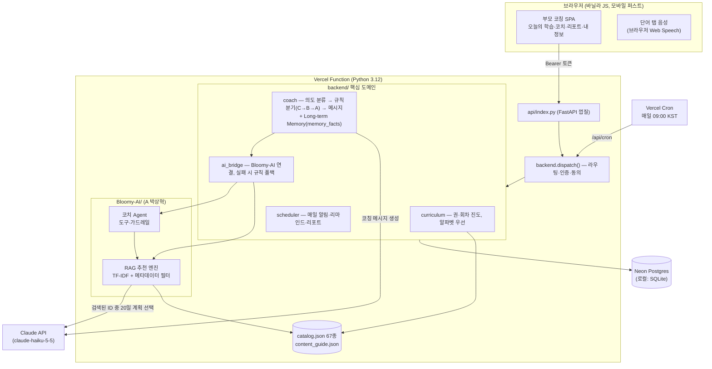
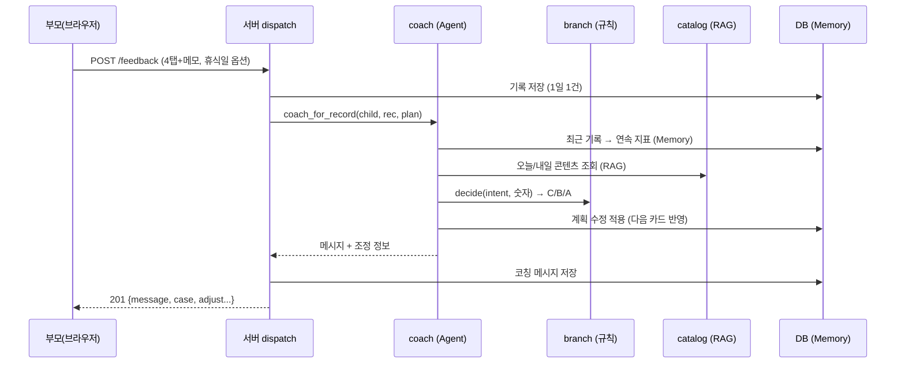

# 요구 명세서: 꽃피다 (Bloomy)

| 항목 | 내용 |
|---|---|
| 문서 버전 | v2.0 (2026-11-20) — `01-기획서.md` v0.5 반영 |
| 관련 문서 | `01-기획서.md` (서비스 기획), `03-작업-계획서.md` (WBS), `04-API-스펙.md` (API 계약), `README.md` (실행 방법) |
| 대상 | AI 네이티브 개발 코스 최종 미션 산출물 |

> v2.0 변경 요약: 대상 연령 **만 4~7세**, 요금·구독 **제거**(학습 성취 리포트로 대체),
> 피드백 척도 **1~5점**, 분기 **C→B→A 규칙 엔진**, 코치 **3단계(의도 분류→규칙 분기→메시지)**,
> 카탈로그 **canonical 스키마**, 자동화 **서버리스 크론**, 아이용 미니러닝 추천 API 추가.

---

## 1. 범위

꽃피다는 **만 4~7세(초등 입학 전) 아이의 영어 자율 학습**을 가정에서 지원하는 AI 코칭 웹 서비스다.
학습은 아이가 하고, 부모(또는 시터)는 매일 1분의 기록(피드백)을 남긴다. AI 코치는 기록에 따라
매일 독려·보완·커리큘럼 조정을 제공하고, 4주 단위 계획, 주간 리포트, 월간 학습 성취 리포트로 이어진다.

**미션 필수 기술 요소 대비표** (≥2개 필수):

| 미션 요구 요소 | 꽃피다 반영 | 구현 위치 |
|---|---|---|
| AI/Agent가 핵심 | 매일 코칭 = Agent가 기록·메모리·큐레이션을 종합해 판단(C→B→A)하고 행동(메시지+계획 조정) | `backend/coach.py`, `backend/branch.py` |
| RAG | 큐레이션 콘텐츠 DB(canonical 스키마)가 코치·추천의 근거 지식이 됨 — 콘텐츠 정보에만 근거 | `backend/catalog.py`, `backend/data/catalog.json` |
| Long-term Memory | 최근 기록에서 연속 지표(연속일/이해도 저하/흥미 저하/순항)를 추출해 판단·메시지에 활용 | `coach.memory_summary()`, `memory_facts` |
| 자동화 워크플로우 | 매일 카드 발송 · 미기록 리마인더 · 주간 리포트 · 월간 성취 리포트 (서버리스 크론) | `backend/scheduler.py`, `/api/cron` |
| 멀티모달 | 미반영 (v2: 음성 피드백·사진 학습 기록) | — |

→ **Agent + RAG + Memory + 자동화 = 4개 요소 충족**

---

## 2. 기능 요구사항 (FR)

| ID | 요구사항 | 우선순위 | 구현 | 검증 |
|---|---|---|---|---|
| FR-01 | 이메일(=ID) + 비밀번호로 가입. 실명 인증 없음(계정을 시터·가족과 공유할 수 있어야 함) | M | `POST /api/register` | 스모크: register, duplicate 409 |
| FR-02 | 로그인/토큰 발급(30일 만료) | M | `POST /api/login`, `auth.py` | 스모크: login, wrong pw 401 |
| FR-03 | 아이 프로필 등록: **나이(4~7)**, 닉네임, 영어유치원 여부, 영어 노출 정도, 보유 교재, 좋아하는 주제, 세션 길이(10~120분: 10/15/20/30/40/50/60/90/120) | M | `POST /api/children` | 스모크: create child |
| FR-04 | 프로필 + 5문항 진단으로 **4주(20 학습일, 월~금) 계획 초안(draft)** 생성 — 부모 승인 전 비활성 | M | `catalog.generate_plan()`, `POST .../plans` | 스모크: plan 20 days |
| FR-05 | 오늘 학습 화면: 콘텐츠(제목·단계·유형·분량·제공 방식), 링크 또는 교재 구입 안내, 확인 포인트 | M | `GET /api/children/{id}/today` | 스모크: today |
| FR-06 | **1분 피드백 기록**: 완료도(full/partial/none)·만족도(1~5)·흥미(1~5)·이해도(1~5) + 자유 메모 + **휴식일** 옵션. 같은 날짜 1건만, 미래 날짜 불가 | M | `POST /api/children/{id}/feedback` | 스모크: 409/400, rest_day |
| FR-07 | **AI 코칭 메시지** — C(수정·질문): 조정안/답변 / B(부분 미달): 쉬운 설명+내일 연습 / A(순항, 디폴트): 독려+내일 리마인드 | M | `coach.coach_for_record()`, `branch.decide()` | 스모크: case A/B/C |
| FR-08 | **분기 규칙 엔진**: 우선순위 **C→B→A**, A는 디폴트. 공백(단발 흥미 저하는 A로 수렴)·중복(B+C 동시면 C 우선, 난이도 조정 포함) 자동 해소. LLM 밖에서 코드로 선판정 | M | `branch.decide()` | 스모크: 공백·중복 케이스 |
| FR-09 | 코치 메시지 히스토리 (케이스 배지, AI 생성 표기) | M | `GET /api/children/{id}/messages` | 스모크: messages |
| FR-10 | 주간 리포트: 학습일/계획일, 이해도·흥미도 추이, 새로 익힌 것, 다음 주 선택지, 확신 문구(데이터 조건부)·정직한 안내 | M | `GET .../report`, `coach.weekly_report()` | 스모크: report |
| FR-11 | **월간 학습 성취 리포트**: 연속 학습일·새로 익힌 것·추이 (요금·청구와 무관) | M | `GET .../achievement`, `coach.monthly_achievement()` | 스모크: achievement |
| FR-12 | 새 4주 계획 생성(기존 계획 종료) | M | `POST .../replan` | 스모크: replan |
| FR-13 | 콘텐츠 서재 검색: 나이/단계/스킬/유형/키워드 필터 | M | `GET /api/catalog` | 스모크: catalog ×3 |
| FR-14 | 알림: 환영·오늘의 학습·미기록 리마인더·주간 리포트·월간 성취. 미읽음 개수, 일괄 읽음 | M | `GET/POST /api/notifications` | 스모크: notifications |
| FR-15 | 설정 변경: 닉네임, 세션 길이(10~120분) | L | `POST .../settings` | 스모크: settings |
| FR-16 | 계정별 자원 격리: 타 계정 아이 접근 불가 | M | `_own_child()` 소유 검사 | 스모크: 404 ×2 |
| FR-17 | **아이용 미니러닝 서버 추천**: 학습 기록·관심사 기반 단어/표현 추천(부분집합만), 난이도·소요시간 산출 | M | `POST /api/learning/recommendation`, `learning.py` | 스모크: learning ×10 |
| FR-18 | **권·회차 단위 카드**: ORT·Songbirds·Elephant & Piggie·Jolly Phonics·Peppa Pig는 『책 제목』·회차까지 지정하고, 이전 계획의 진도에서 이어감(첫 읽기 → 다시 읽기 → 다음 권). 활동·확인 포인트는 자료의 주 목표 하나에 맞춤 | M | `curriculum.apply()`, `goal_text()`, `data/content_guide.json` | 스모크: curriculum |
| FR-19 | **카드 자료 안내**: 자료가 무엇인지·찾는 법·공식 링크·비용·추천 이유·부모 역할·기록 근거(지난 기록이 있을 때만). 구체적 후보가 충분하면 '앱 전체' 같은 묶음 항목은 계획에서 제외 | M | `curriculum.card_info()`, `basis()`, `today.card.guide` | 스모크: card_info, 묶음 제외 |
| FR-20 | **지난 학습일 보기·밀린 기록**: 오늘의 학습에서 지난 날짜를 골라 카드 확인·기록 | M | `GET .../today?date=` (미래·잘못된 형식 400) | 스모크: today date |
| FR-21 | **단어 탭 음성**: 단어·표현·글자 카드를 누르면 영어 음성(브라우저 내장 TTS, en-US). 한국어 뜻은 부모용 토글로만, 한글 발음 표기 없음. 앱 안 브라우저면 Safari·Chrome 안내 | M | `learning/js/app.js` (`speak`, `data-say`) | 화면 확인 |
| FR-22 | **알파벳 우선 계획**: 진단에서 알파벳 '인지 못 함'이면 첫 주는 외부 알파벳 자료를 먼저 배치하고 카드에 '오늘의 글자' 표시 | M | `curriculum.alphabet_first()`, `letters_for()` | 스모크: alphabet |
| FR-23 | **주간 기록 한눈에**: 리포트에 날짜별 자료·완료·흥미·이해도·메모. 기록 3일 미만이면 추세 판단 보류 | M | `coach.weekly_report().days`, `MIN_TREND_DAYS` | 스모크: report |
| FR-24 | **오늘의 동요**: 학습 단계(L1~L5)에 맞는 영어 동요 1곡을 날마다 공식 채널 YouTube 링크로 안내(앱 안 재생 없음). 사흘에 한 번 한 단계 아래 복습, 알파벳 '인지 못 함'이면 알파벳·글자 소리 노래. 부모와 함께 할 활동 표시 | M | `songs.song_for()`, `data/songs.json`(52곡), `today.song`, 링크 확인 `scripts/check_songs.py` | 스모크: songs |

우선순위: M = 미션 데모에 필수, L = 있으면 좋음.

---

## 3. 비기능 요구사항 (NFR)

| ID | 요구사항 | 목표 | 비고 |
|---|---|---|---|
| NFR-01 | 코칭 응답 시간 | 기록 저장 후 <8초 내 메시지 표시 | 룰베이스: 즉시 / LLM: 타임아웃, 실패 시 룰베이스 폴백 |
| NFR-02 | 피드백 UX | 4탭 + 1메모로 1분 이내 완료 (목표 30초) | 모바일 퍼스트 UI |
| NFR-03 | 가용성 | 일일 카드 발송 성공률 99% 이상, 실패 시 재시도 | 서버리스 크론 |
| NFR-04 | 비밀번호 저장 | 원문 저장 금지, PBKDF2-HMAC-SHA256 200k + salt + pepper | `auth.py` |
| NFR-05 | 인증 | 토큰 HMAC 서명 + 30일 만료, 계정별 자원 소유 검사 | `auth.check_token` |
| NFR-06 | 개인정보 최소화 | 아이 이름·생일 미수집(닉네임만), 이메일은 계정 식별 용도 | 가입 시 동의 명시 |
| NFR-06a | 개인정보 동의·철회 | 가입 시 수집·이용(AI 처리 포함)·법정대리인 동의 필수, 버전·시각 기록 / 탈퇴 시 계정·아이 데이터 즉시 전부 삭제 | `consent.py`, `POST /api/register`·`/api/me/consent`·`/api/me/delete`, 스모크 |
| NFR-07 | AI 투명성 | 모든 AI 생성 코칭 메시지에 "AI가 작성한 코칭 메시지입니다." 라벨 | 프롬프트 강제 + 룰베이스 동일 라벨 |
| NFR-08 | 가드레일 | 발달 진단·의료 표현·학습 효과 보증 금지, 근거 없는 사실 생성 금지 | 시스템 프롬프트 + 룰베이스 템플릿 |
| NFR-09 | 테스트성 | HTTP 소켓 없이 엔드포인트 전체 검증 가능 | `main.dispatch()` 분리, 스모크 132개 |
| NFR-10 | 이식성 | 로컬은 외부 의존성 0개(표준 라이브러리), 운영은 FastAPI+Postgres | `python3 backend/main.py` / `api/index.py` |

---

## 4. 시스템 아키텍처

> 2026-11-24 갱신: 실제 배포 구성(Vercel·Neon·Claude)과 Bloomy-AI 모듈 연결을 반영.

요청 흐름(핵심 루프):

### 4.1 기술 선택과 구현 중 변경

기획 단계의 선택과 이유는 `01-기획서.md` §8.2에 있습니다. 구현하면서 바뀐 것은 다음과 같습니다.

| 항목 | 기획 (§8.2) | 실제 구현 | 이유 |
|---|---|---|---|
| RAG 검색 | PostgreSQL + pgvector 임베딩 | **로컬 TF-IDF**(한글 2글자 단위 토큰) + 메타데이터 필터, 벡터 DB 없음 | ① AI 모듈은 API 키·네트워크·DB 없이 혼자 실행하고 테스트할 수 있게 만든다는 원칙을 세웠고, 검색도 이 원칙에 맞춰 외부 모델 없이 구현했다. ② 카탈로그가 67종 규모라 후보 대부분은 나이·단계·학습 시간 **필터에서 이미 걸러지고**, 유사도는 남은 후보의 순서만 정한다. 이 규모에서는 임베딩이 정확도를 크게 높이지 못한다고 판단했다. ③ 임베딩 API는 검색마다 별도 키·비용·지연을 만들고, 임베딩 모델을 직접 올리면 서버리스 함수 용량 제한에 걸린다. ④ 같은 입력에 같은 결과가 나오므로 계획 검증 테스트를 안정적으로 유지할 수 있다. 검색기는 `Retriever` 인터페이스로 분리해 두어, 카탈로그가 커지면 벡터 검색으로 교체할 수 있다 |
| LLM | 상용 LLM API + 구조화 출력 | **Claude `claude-haiku-5-5`** + JSON 스키마 검증, 실패 시 규칙 기반 폴백 | 부모에게 보내는 한국어 문장 표현은 Claude가 가장 낫다고 판단했다. 계획은 검색된 자료 ID 중에서 고르고 코칭은 정해진 규칙(A·B·C) 안에서 문장을 만드는 일이라 가장 작은 모델로 충분하다고 보고 haiku로 시작했다. 결과가 기대에 못 미치면 상위 모델로 올릴 계획이었으나, 운영 중 문장 품질에 문제가 없어 유지했다 |

---

## 5. AI 활용 명세

| 기능 | 방식 | 입력 | 출력 | 모델/폴백 |
|---|---|---|---|---|
| 4주 학습 계획 | **RAG + LLM** (구조화 출력) | 나이·목표·노출·세션 길이·보유 교재·관심사 | 20일 계획 + 학습 방법 설명(콘텐츠명 인용) | Claude `claude-haiku-5-5`, 실패 시 규칙 기반 폴백 |
| **메모 의도 분류** | LLM (스키마 제약) / 키워드 룰 | 부모 메모 | `{intent: none/question/change_request/out_of_scope, reason}` | 실패 시 키워드 분류기 폴백 |
| **분기 판정** | 룰 (LLM 미사용) | intent 라벨 + 피드백 숫자 + 연속 지표 | `{case: A/B/C, flags, reasons}` | `branch.decide()` — 감사 가능 |
| **매일 코칭 메시지** | LLM + 시스템 프롬프트 / 룰베이스 | 오늘 기록, 메모, 콘텐츠 정보(RAG), 최근 추이(Memory), 내일 계획 | `{case, body, tomorrow_card, confidence_sentence?}` JSON | `BLOOMY_LLM_MODEL`(기본 Claude `claude-haiku-5-5`), 실패 시 룰베이스 폴백 |
| 커리큘럼 조정 | 규칙 판정 → 결정적 실행 | 메모 의도, 이해도/흥미 연속 지표 | 다음 카드 난이도·소재·길이 조정 | LLM 판단도 결정적 실행 함수로만 반영 |
| 주간 리포트 | 룰 (통계+템플릿) | 주간 기록 분포, 계획일 | 추이 + 코멘트 + 선택지 | 확신 문구는 데이터 조건부 |
| 월간 학습 성취 | 룰 | 월간 기록일/계획일 | 연속 학습일·새로 익힌 것·추이 | 요금 무관 |
| 오늘의 동요 | 룰 (결정적 순환) | 계획 단계(base_level)·진단(알파벳)·날짜 | 공식 채널 YouTube 링크 1곡 + 부모와 함께 할 것 | `songs.song_for()` |
| 미니러닝 추천 | 룰 (결정적) | 프로필·진단·학습 통계·보유 단어/표현 | 부분집합 추천 + 난이도·소요시간 | `learning.recommend()` |
| 자동화 (알림 4종) | 스케줄러 / 서버리스 크론 | 시간표 + 상태 | 알림 | — |

**RAG 설계**: **구조화 큐레이션 DB(JSON)** 를 RAG 소스로 사용 — 콘텐츠가
`id·title·age_min/max·level(L1~L5)·skill·type·provider·link·session_minutes·expert_note·trust_source`
canonical 필드로 정리되어 있고, **메타데이터 필터(나이·단계·세션) + TF-IDF 벡터 유사도**로 검색한 뒤
**Claude가 검색된 콘텐츠 ID 안에서만 골라 20일 계획과 학습 방법을 생성**한다(구조화 JSON 검증, 콘텐츠명 인용).
LLM 호출/스키마 검증이 실패하면 **규칙 기반 초안으로 자동 폴백**한다. (운영 확장: 임베딩 DB로 전환 가능)

**Long-term Memory 설계**: 세션 메모리가 아니라 **DB의 학습 기록 자체가 메모리**.
`memory_summary()`가 최근 기록에서 연속 지표(연속일, 이해도 저하 연속, 흥미 저하 연속, 순항 연속)를
계산해 ① 분기 판정 ② 메시지 톤에 쓴다. 선호 소재·실패 지점은 `memory_facts`에 저장한다.

**프롬프트 가드레일** (`coach` 시스템 프롬프트):
철학(증서 아님/영어로 사고하기) 전파 · 3~5문장 · 발달 진단·효과 보증 금지 · 근거 제한 ·
내일 학습 포함 · AI 라벨 필수 · JSON-only 출력 계약 · 확신 문구는 데이터 조건부.

---

## 6. 데이터 사전 (v0.5 스키마)

| 테이블 | 주요 필드 | 설명 |
|---|---|---|
| `users` | id, email(UNIQUE), password_hash, salt, created_at | 이메일=ID. 비밀번호는 PBKDF2 해시만 |
| `children` | id, user_id, name, age(4~7), birth_year, ek_kindergarten, exposure(none/some/much), materials, favorite_topics, session_length(10~120), diagnosis(JSON), level | 아이 프로필. 실명 정보 없음 |
| `contents` | id, title, age_min, age_max, level(1~5), skill, type, provider(purchase/link), link, session_minutes, expert_note, trust_source | 큐레이션 카탈로그 (canonical) |
| `plans` | id, child_id, week_start, status(draft/approved/done), source, base_level, explanation | 4주 계획. 승인 전 draft |
| `cards` | id, plan_id, child_id, date, content_id, task, minutes, check_point, status | 일별 학습 카드 |
| `feedbacks` | id, child_id, card_id, date, completion(full/partial/none), satisfaction(1~5), interest(1~5), comprehension(1~5), memo, rest_day, memo_intent | 1일 1건 피드백 |
| `coach_messages` | id, child_id, feedback_id, date, branch(A/B/C), memo_intent, body, model, prompt_version, is_ai_generated | AI 코칭 이력 (버전 추적) |
| `memory_facts` | id, child_id, kind, value, updated_at | Long-term Memory (선호·실패 지점 등) |
| `notifications` | id, user_id, title, body, kind, read_at, created_at | 계정 단위 알림 |
| `meta` | key, value | 크론 중복 발송 방지 키 등 |

피드백 값 도메인: `completion ∈ {full, partial, none}`, `satisfaction/interest/comprehension ∈ 1~5`,
`rest_day ∈ {0,1}`, `memo_intent ∈ {none, question, change_request, out_of_scope}`.

---

## 7. API 요약

| Method | Path | 설명 | 인증 |
|---|---|---|---|
| GET | `/api/health` | 헬스체크 | — |
| GET | `/api/diagnosis/questions` | 5문항 진단 정의 | — |
| POST | `/api/register` / `/api/login` | 가입 / 로그인 (토큰 발급) | — |
| GET | `/api/me` | 계정 + 아이 목록 | O |
| POST | `/api/children` | 아이 생성 + 진단 + 계획 초안 + 환영 알림 | O |
| POST | `/api/children/{id}/plans` | 계획 초안 업로드 (RAG 추천) | O·소유 |
| POST | `/api/children/{id}/plans/{plan_id}/approve` | 계획 승인(활성화) | O·소유 |
| GET | `/api/children/{id}/today` | 오늘(또는 다음 학습일) + 기록 + 최근 코치 메시지 | O·소유 |
| GET | `/api/children/{id}/plan` / `messages` / `report` / `achievement` / `stats` | 계획 / 코치 이력 / 주간 리포트 / 월간 성취 / 대시보드 | O·소유 |
| POST | `/api/children/{id}/feedback` | 1분 피드백 → 3단계 코칭 | O·소유 |
| POST | `/api/children/{id}/replan` / `settings` | 새 계획 / 설정 변경 | O·소유 |
| GET | `/api/catalog?age&level&skill&type&keyword` | 큐레이션 검색 | — |
| GET/POST | `/api/notifications` / `/api/notifications/read` | 알림 / 일괄 읽음 | O |
| POST | `/api/learning/recommendation` | 아이용 미니러닝 추천 | O |
| POST | `/api/cron` | 서버리스 크론(daily/remind/weekly/monthly) | 크론 시크릿 |

---

## 8. AI 윤리 및 개인정보

1. **AI 생성 표시**: 모든 코칭 메시지에 "AI가 작성한 코칭 메시지입니다." 문구를 프롬프트로
   강제하고, 룰베이스 폴백에도 동일 라벨을 붙이며, UI에 'AI 코칭 메시지' 배지를 표시한다.
2. **발달 안전**: 영유아 대상이므로 발달 진단·의료 표현·"N개월 내 효과" 같은 보장을 금지하는
   가드레일을 프롬프트와 템플릿 양쪽에 둔다. 코치가 할 수 있는 '조정'은 콘텐츠 난이도/순서
   변경뿐이며, 그 이유를 부모에게 설명한다.
3. **개인정보 최소화**: 아이의 이름·생일을 수집하지 않는다(닉네임만). 이메일은 계정 식별
   용도이며, 비밀번호는 PBKDF2(200k)+salt+pepper로 해시한다. (기획서 §8.4 동의 절차와 동일)
4. **근거 제한 (할루시네이션 제어)**: 코치는 제공된 큐레이션 콘텐츠 정보에만 근거하도록
   지시하고, LLM이 계획 조정 등 **사실성 있는 변경**을 할 때는 결정적 실행 함수로만 반영한다.
5. **투명성**: `coach_messages.prompt_version`으로 메시지 생성 방식(룰/LLM, 버전)을 추적한다.
6. **확신 문구 데이터 조건부**: "옳은 길로 가고 있다" 같은 확신 문장은 주간 추이가 양호할 때만
   생성하고, 하락·미해결 주에는 조정 사실을 솔직히 전달한다(고정 삽입 금지).

---

## 9. 검증 현황

- `scripts/smoke_test.py`: **132개 체크 전부 통과** (가입/로그인/계획/피드백 A·B·C/분기 공백·중복/
  조정 적용/리포트/성취/대시보드/서재/알림/설정/재계획/권한 격리/스케줄러/크론/미니러닝 추천/
  권·회차 커리큘럼/카드 안내/날짜 선택/알파벳 우선/오늘의 동요/카탈로그 문서 최신 여부)
- `scripts/check_songs.py`: 동요 52곡 링크가 열리고 공식 채널인지 YouTube oEmbed로 확인 (52/52)
- `Bloomy-AI` 단위 테스트 84개 통과
- 실사용자 테스트: 보호자 5명, 결과는 `docs/user-test.md`
- 실행: `python3 scripts/smoke_test.py`

## 10. 오픈 이슈 (기획서 부록과 동일)

1. 서비스명은 가제 "꽃피다" — 네이밍 검증 필요
2. ~~카탈로그 60개 확보~~ — 해결: 67개(이 중 31개는 권·회차·단일 제목까지 지정, 36개는 묶음)
3. LLM 모델/비용 — `claude-haiku-5-5` 기준, 대량 사용자 시 캐싱 정책 필요
4. ~~루트 부모 코칭 SPA 재작성~~ — 해결: `learning/` 통합 앱으로 재구성
