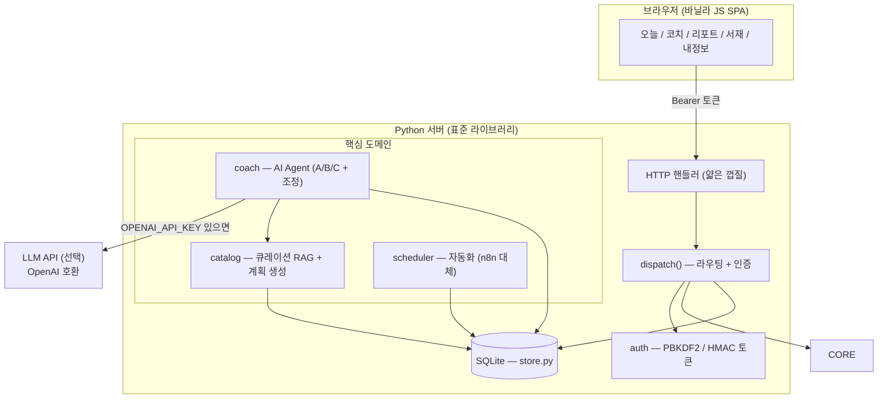
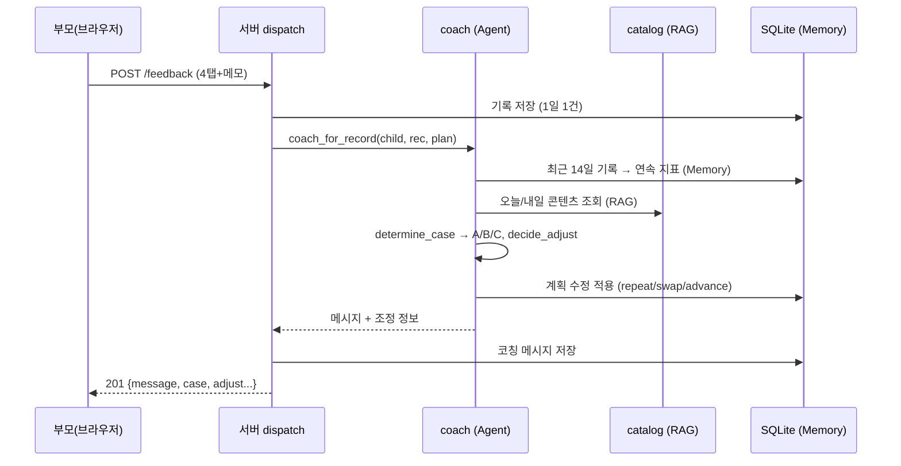

# 요구 명세서: 꽃피다 (Bloomy)

| 항목 | 내용 |
|---|---|
| 문서 버전 | v1.0 (2026-11-09) |
| 관련 문서 | `01-기획서.md` (서비스 기획), `README.md` (실행 방법) |
| 대상 | AI 네이티브 개발 코스 최종 미션 산출물 |

---

## 1. 범위

꽃피다는 **만 3세~6세(초등 입학 전) 아이의 영어 자율 학습**을 가정에서 지원하는 AI 코칭 웹 서비스다.
학습은 아이가 하고, 부모(또는 시터)는 매일 1분의 기록(피드백)을 남긴다. AI 코치는 기록에 따라
매일 독려·보완·커리큘럼 조정을 제공하고, 4주 단위 계획, 주간 리포트, 월간 구독 성취도로 이어진다.

**미션 필수 기술 요소 대비표** (≥2개 필수):

| 미션 요구 요소 | 꽃피다 반영 | 구현 위치 |
|---|---|---|
| AI/Agent가 핵심 | 매일 코칭 = Agent가 기록·메모리·큐레이션을 종합해 판단(A/B/C)하고 행동(메시지+계획 조정) | `backend/coach.py` |
| RAG | 큐레이션 콘텐츠 DB(50종, 나이·발달 단계 구조화)가 코치의 근거 지식이 됨 — 콘텐츠 정보에만 근거, 지어내지 않기 | `backend/catalog.py`, `data/catalog.json` |
| Long-term Memory | 최근 14일 기록에서 연속 지표(연속일/이해도 저하/흥미 저하/순항)를 추출해 판단·메시지에 활용 | `coach.memory_summary()` |
| 자동화 워크플로우 | 매일 아침 알림 · 21시 리마인드 · 일요일 주간 리포트 · 1일 구독 갱신 (개발: 프로세스 내 스케줄러, 운영: n8n) | `backend/scheduler.py` |
| 멀티모달 | 미반영 (v2: 음성 피드백·사진 학습 기록) | — |

→ **Agent + RAG + Memory + 자동화 = 4개 요소 충족**

---

## 2. 기능 요구사항 (FR)

| ID | 요구사항 | 우선순위 | 구현 | 검증 |
|---|---|---|---|---|
| FR-01 | 이메일(=ID) + 비밀번호로 가입. 실명 인증 없음(계정을 시터·가족과 공유할 수 있어야 함) | M | `POST /api/register` | 스모크: register, duplicate 409 |
| FR-02 | 로그인/토큰 발급(30일 만료) | M | `POST /api/login`, `auth.py` | 스모크: login, wrong pw 401 |
| FR-03 | 아이 프로필 등록: 나이(3~6), 닉네임, 영어유치원 여부, 영어 노출 정도, 하루 학습 분량 | M | `POST /api/children` | 스모크: create child |
| FR-04 | 프로필 기반으로 **4주(20 학습일, 월~금) 계획 자동 생성** — 시작 단계는 나이+유치원+노출로 결정, 3주차부터 단계 +1, 수요일은 듣기 워밍업, 금요일은 +1 도전 | M | `catalog.generate_plan()` | 스모크: plan 20 days, weekday check |
| FR-05 | 오늘 학습 화면: 콘텐츠(제목·단계·유형·분량·무료/구매), 링크(유튜브·앱) 또는 교재 구입 안내, 추천 이유, TIP | M | `GET /api/children/{id}/today`, frontend 오늘 뷰 | 스모크: today |
| FR-06 | **1분 피드백 기록**: 완료도(full/partial/none)·만족도(happy/neutral/sad)·흥미(high/low)·이해도(good/unsure/poor) + 자유 메모. 같은 날짜 1건만 가능, 미래 날짜 불가 | M | `POST /api/children/{id}/feedback` | 스모크: 409/400 케이스 |
| FR-07 | **AI 코칭 메시지** — A(순항): 독려+내일 리마인드 / B(미완주): 쉬운 설명+내일 소규모 연습+격려 / C(구체 피드백): 분석+응대 | M | `coach.coach_for_record()` | 스모크: case A/B/C |
| FR-08 | **커리큘럼 자동 조정**: repeat(동일 단계 반복 2일) / swap(동일 단계 다른 콘텐츠) / advance(한 단계 상승) — 메모 키워드 + 메모리 연속 지표로 판단, 이후 학습일에 적용 | M | `coach.decide_adjust()`, `apply_adjust()` | 스모크: adjust applied |
| FR-09 | 코치 메시지 히스토리 (케이스 배지 포함) | M | `GET /api/children/{id}/messages` | 스모크: messages |
| FR-10 | 주간 리포트: 학습일/계획일, 완료도·이해도 분포, 추이 판단(상승/꾸준/서포트), 코멘트 | M | `GET .../report`, `coach.weekly_report()` | 스모크: report |
| FR-11 | 월간 구독 성취도: (기록일/계획일) 비율, **80% 이상 → 다음 달 10만 원**(기본 30만 원). "꾸준함의 상" 포지셔닝 | M | `GET .../subscription`, `coach.subscription_status()` | 스모크: subscription |
| FR-12 | 새 4주 계획 생성(기존 계획 종료) | M | `POST .../replan` | 스모크: replan |
| FR-13 | 콘텐츠 서재 검색: 단계/유형/키워드/나이 필터 | M | `GET /api/catalog` | 스모크: catalog ×3 |
| FR-14 | 알림: 환영·오늘의 학습·저녁 리마인드·주간 리포트·구독 갱신. 미읽음 개수, 일괄 읽음 | M | `GET/POST /api/notifications` | 스모크: notifications |
| FR-15 | 설정 변경: 닉네임, 하루 분량(5~60분) | L | `POST .../settings` | 스모크: settings |
| FR-16 | 계정별 자원 격리: 타 계정 아이 접근 불가 | M | `_own_child()` 소유 검사 | 스모크: 404 ×2 |

우선순위: M = 미션 데모에 필수, L = 있으면 좋음.

---

## 3. 비기능 요구사항 (NFR)

| ID | 요구사항 | 목표 | 비고 |
|---|---|---|---|
| NFR-01 | 코칭 응답 시간 | 기록 저장 후 <5초 내 메시지 표시 | 룰베이스: 즉시 / LLM: 타임아웃 40초, 실패 시 룰베이스 폴백 |
| NFR-02 | 피드백 UX | 4탭 + 1메모로 1분 이내 완료 | 모바일 퍼스트 UI |
| NFR-03 | 가용성 | 95% (단일 인스턴스 배포 기준) | Render 무료 티어 1 인스턴스, 스케줄러는 프로세스 내 |
| NFR-04 | 비밀번호 저장 | 원문 저장 금지, PBKDF2-HMAC-SHA256 200k + salt + pepper | `auth.py` |
| NFR-05 | 인증 | 토큰 HMAC 서명 + 30일 만료, 계정별 자원 소유 검사 | `auth.check_token` |
| NFR-06 | 개인정보 최소화 | 아이 이름·생일 미수집(닉네임만), 이메일은 계정 식별 용도 | 개인정보 동의는 가입 시 명시 |
| NFR-07 | AI 투명성 | 모든 AI 생성 코칭 메시지에 "AI가 작성한 코칭 메시지입니다." 라벨 | 프롬프트 강제 + 룰베이스에도 동일 라벨 |
| NFR-08 | 가드레일 | 발달 진단·의료 표현·학습 효과 보증 금지, 근거 없는 사실 생성 금지 | 시스템 프롬프트 + 룰베이스 템플릿에 내재 |
| NFR-09 | 테스트성 | HTTP 소켓 없이 엔드포인트 전체 검증 가능 | `main.dispatch()` 분리, 스모크 42개 |
| NFR-10 | 이식성 | 외부 의존성 0개 (Python 3.9+ 표준 라이브러리) | 어디서든 `python3 backend/main.py` |

---

## 4. 시스템 아키텍처

요청 흐름(핵심 루프):

---

## 5. AI 활용 명세

| 기능 | 방식 | 입력 | 출력 | 모델/폴백 |
|---|---|---|---|---|
| 4주 학습 계획 |룰 (구조화 로직) | 나이, 유치원 여부, 노출, 분량 | 20일 계획 (단계 패턴+콘텐츠 매칭) | LLM 불요 — 결정적이어야 해 |
| **매일 코칭 (Agent)** | LLM + 시스템 프롬프트 / 룰베이스 | 오늘 기록, 메모, 콘텐츠 정보(RAG), 최근 추이(Memory), 내일 계획 | `{case, message, adjust, adjust_reason}` JSON | `BLOOMY_LLM_MODEL` (기본 gpt-4o-mini), 실패 시 룰베이스 자동 폴백 |
| 커리큘럼 조정 | Agent 판단 → 결정적 실행 | 메모 키워드 우선, 그 외 메모리 연속 지표 | repeat/swap/advance + 적용 날짜 | LLM 판단도 결정적 실행 함수(`apply_adjust`)로만 반영 |
| 주간 리포트 | 룰 (통계+템플릿) | 주간 기록 분포, 계획일 | 추이 + 코멘트 | — |
| 구독 성취도 | 룰 | 월간 기록일/계획일 | % + 다음 달 티어 | — |
| 자동화 (알림 4종) | 스케줄러 (n8n 설계) | 시간표 + 상태 | 알림 | — |

**RAG 설계**: 벡터 DB 없이 **구조화 큐레이션 DB(JSON)** 를 RAG 소스로 사용 — 50개 콘텐츠가
`stage(1~5)·age_min/max·type·minutes·paid·link·why·tip` 필드로 정리되어 있고, 코치는
"오늘/내일 콘텐츠 + 단계 설명"만 컨텍스트에 주입받아 **그 정보에만 근거**해 작성한다.
(운영 확장: 큐레이션 문서 PDF/웹페이지 → 임베딩 DB로 전환 가능, 프롬프트 인터페이스는 동일)

**Long-term Memory 설계**: 세션 메모리가 아니라 **DB의 학습 기록 자체가 메모리**.
`memory_summary()`가 최근 14일에서 4개 연속 지표(연속일, 이해도 'poor' 연속, 흥미 'low' 연속,
순항 연속)를 계산해 ① 조정 판단(decide_adjust) ② 메시지 톤(연속 N일째 축하 등)에 쓴다.

**프롬프트 가드레일** (시스템 프롬프트 전문은 `coach.SYSTEM_PROMPT`):
철학(증서 아님/영어로 사고하기) 전파 · 3~6줄 · 발달 진단·효과 보증 금지 · 근거 제한 ·
내일 학습 포함 · AI 라벨 필수 · JSON-only 출력 계약.

---

## 6. 데이터 사전

| 테이블 | 주요 필드 | 설명 |
|---|---|---|
| `accounts` | id, email(UNIQUE), pw_hash, salt, created_at | 이메일=ID. 비밀번호는 PBKDF2 해시만 |
| `children` | id, account_id, nickname, age(3~6), ek_kindergarten, exposure(none/some/much), daily_minutes | 아이 프로필. 실명 정보 없음 |
| `plans` | id, child_id, status(active/done), base_stage, plan_json | 4주 계획. plan_json = `{base_stage, days[20]}` (date·stage·content_id·minutes·content) |
| `learning_records` | id, child_id, record_date(UNIQUE per child), content_id, completion, satisfaction, interest, comprehension, memo | 1일 1건 피드백 |
| `coaching_messages` | id, child_id, record_id, record_date, case_type(A/B/C), message, prompt_version | AI 코칭 이력 (버전 추적용 prompt_version) |
| `notifications` | id, account_id, title, body, kind(welcome/daily/remind/report/plan/reward/info), read_at | 계정 단위 알림 |
| `meta` | key, value | 스케줄러 중복 발송 방지 키 등 |

피드백 값 도메인: `completion ∈ {full, partial, none}`, `satisfaction ∈ {happy, neutral, sad}`,
`interest ∈ {high, low}`, `comprehension ∈ {good, unsure, poor}`.

---

## 7. API 요약

| Method | Path | 설명 | 인증 |
|---|---|---|---|
| GET | `/api/health` | 헬스체크 | — |
| POST | `/api/register` / `/api/login` | 가입 / 로그인 (토큰 발급) | — |
| GET | `/api/me` | 계정 + 아이 목록 | O |
| POST | `/api/children` | 아이 생성 + 4주 계획 + 환영 알림 | O |
| GET | `/api/children/{id}/today` | 오늘(또는 다음 학습일) + 기록 + 최근 코치 메시지 | O·소유 |
| GET | `/api/children/{id}/plan` / `/messages` / `/report` / `/subscription` | 계획 / 코치 이력 / 주간 리포트 / 구독 성취도 | O·소유 |
| POST | `/api/children/{id}/feedback` | 1분 피드백 → 코칭 생성 | O·소유 |
| POST | `/api/children/{id}/replan` / `/settings` | 새 계획 / 설정 변경 | O·소유 |
| GET | `/api/catalog?age&stage&type&keyword` | 큐레이션 검색 | — |
| GET/POST | `/api/notifications` / `/api/notifications/read` | 알림 / 일괄 읽음 | O |

---

## 8. AI 윤리 및 개인정보

1. **AI 생성 표시**: 모든 코칭 메시지에 "AI가 작성한 코칭 메시지입니다." 문구를 프롬프트로
   강제하고, 룰베이스 폴백에도 동일 라벨을 붙이며, UI에 'AI 코칭 메시지' 배지를 표시한다.
2. **발달 안전**: 영유아 대상이므로 발달 진단·의료 표현·"N개월 내 효과" 같은 보장을 금지하는
   가드레일을 프롬프트와 템플릿 양쪽에 둔다. 코치가 할 수 있는 '조정'은 콘텐츠 난이도/순서
   변경뿐이며, 그 이유를 부모에게 설명한다.
3. **개인정보 최소화**: 아이의 이름·생일을 수집하지 않는다(닉네임만). 이메일은 계정 식별
   용도이며, 비밀번호는 PBKDF2(200k)+salt+pepper로 해시한다. (기획서 §12 동의 절차와 동일)
4. **근거 제한 (할루시네이션 제어)**: 코치는 제공된 큐레이션 콘텐츠 정보에만 근거하도록
   지시하고, LLM이 계획 조정 등 **사실성 있는 변경**을 할 때는 결정적 실행 함수로만 반영한다.
5. **투명성**: `coaching_messages.prompt_version`으로 메시지 생성 방식(룰/LLM, 버전)을 추적한다.

---

## 9. 검증 현황

- `scripts/smoke_test.py`: **42개 체크 전부 통과** (가입/로그인/계획/피드백 A·B·C/조정 적용/
  리포트/구독/서재/알림/설정/재계획/권한 격리/스케줄러)
- 실행: `python3 scripts/smoke_test.py`

## 10. 오픈 이슈 (기획서 부록과 동일)

1. 서비스명은 가제 "꽃피다" — 네이밍 검증 필요
2. 구독 티어 기준 80% — 5세대 테스트 후 조정
3. LLM 모델/비용 — `gpt-4o-mini` 기준, 대량 사용자 시 캐싱 정책 필요
4. 무료 체험(첫 7일?) 여부 — 미결정
