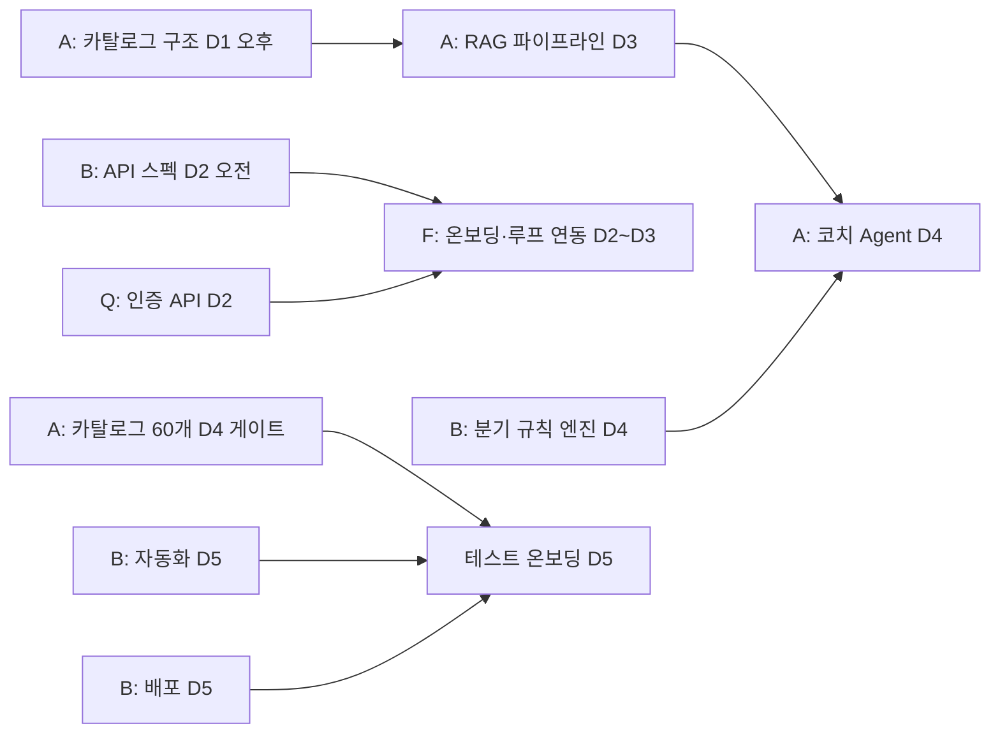

# 03. 작업 계획서 (WBS) — 꽃피다 (Bloomy)

> 4인 팀이 5일(월 D1 ~ 금 D5) 스프린트로 나눠서 작업할 계획서. 기획서(`01-기획서.md`)의 11절(5일 일정), 13절(4인 역할)의 실행판이다.
> 실사용자 테스트는 **D5(금) 온보딩부터 2주 병행 운영**하며, 기존 `02-요구-명세서.md`(11/9 구현 기반 명세)는 D2에서 기획서 v0.4에 맞게 갱신한다.
>
> | 항목 | 내용 |
> |------|------|
| 버전 | v0.4 (03 명칭 변경 · 01 v0.5 일관성 반영) |
| 날짜 | 2026-11-16 |
> | 기준 문서 | `01-기획서.md` v0.4 |

## 1. 역할 정의 (4인)

| 코드 | 역할 | 담당 업무 (13절 기준) |
|------|------|----------------------|
| **B** | PM / 백엔드 | 일정·범위 관리, API·인증·DB, 배포, 리스크 관리 |
| **A** | AI / 데이터 | 두 핵심 AI(커리큘럼 RAG, 코치 Agent), 프롬프트·가드레일·Memory, **카탈로그 구축(전담 코디) + 전문가 검수 조율** |
| **F** | 프론트엔드 / 콘텐츠 | 온보딩·데일리 루프·리포트·대시보드 UI, 카탈로그 구축 지원, 코칭 문장 검수 |
| **Q** | QA / 사용자 테스트 / 문서 | 테스터 모집·운영, 이슈 트래킹, 발표 자료·README·시연 영상, 카탈로그 구축 지원 |

- 팀원 이름은 확정 후 이 표에 기재
- **B = PM**이다: 일정 관리·리스크 로그·게이트 체크는 B가 소유
- **카탈로그 60개는 4인 전원**이 D1부터 분담 구축 (A가 코디, F·Q가 항목 작성 지원, B는 seed 스크립트)
- QA(회귀 확인)는 4인 모두 분담, 테스트 기간(D5 + 2주)에 집중

## 2. 일별 작업 분담 (D1~D5)

### D1 (월) — 기반·진단

| 담당 | 작업 | 산출물 |
|------|------|--------|
| B | GitHub 저장소 구조·브랜칭·커밋 컨벤션, DB 스키마 확정(8.3) + PostgreSQL/Neon 워크스페이스, 카탈로그 seed 스크립트 | 저장소, DB, seed 스크립트 |
| A | 카탈로그 구조 설계(7.1: 필드·단계 L1~L5·나이별 매핑) + **오후까지 구조 확정(게이트)** + 부모 인터뷰 5건, 카탈로그 10개 | 카탈로그 구조, 인터뷰 노트, 카탈로그 10개 |
| F | 와이어프레임(온보딩·데일리 루프·리포트·대시보드), 카탈로그 10개 | 와이어프레임, 카탈로그 10개 |
| Q | **테스터 모집 채널 오픈·8가구 목표 진행**, 카탈로그 10개, 테스트 계획·인터뷰 설문지 초안 | 모집 시작, 카탈로그 10개, 테스트 도구 |

### D2 (화) — 명세서·온보딩·인증

| 담당 | 작업 | 산출물 |
|------|------|--------|
| B | **기능 요구 명세서 갱신**(`02-요구-명세서.md`를 기획서 v0.4에 맞게: 4~7세, 핵심 AI 2개, 카탈로그 60개, 서버리스 크론) + API 스펙 확정(아침까지) | 요구 명세서 v2, API 스펙 |
| A | 요구 명세서 AI 활용 명세(6절) 갱신, **LLM API 비교·확정**, RAG 코퍼스 청킹 설계, 카탈로그 10개 | 요구 명세서(부분), LLM 확정, 카탈로그 10개 |
| F | 요구 명세서 UI 요구사항 작성, **온보딩 UI** (프로필 + 5문항 체크 + 단계 진단 가설 화면), 카탈로그 10개 | 요구 명세서(부분), 온보딩 화면, 카탈로그 10개 |
| Q | **이메일+비밀번호 인증 구현**(단방향 해시, 5.7절), 카탈로그 10개 | 인증 API, 카탈로그 10개 |
| 4인 | **게이트 G1 (17:00)**: 요구 명세서 전체 리뷰·승인 | 요구 명세서 확정 |

### D3 (수) — 핵심 AI ① (커리큘럼 추천, RAG)

| 담당 | 작업 | 산출물 |
|------|------|--------|
| B | 온보딩 백엔드 API (프로필 저장 + 진단 + 계획 승인 플로우), 카탈로그 seed 실행·검증 | 온보딩 API |
| A | **RAG 파이프라인** (인덱싱, 메타데이터 필터+벡터 검색, 6.2절) + **커리큘럼 추천** (4주 계획 초안 + 학습 방법 설명, 구조화 출력, 콘텐츠명 인용) + 프롬프트 v1 | 커리큘럼 추천 동작 |
| F | 온보딩-백엔드 연동, **데일리 루프 UI** (오늘의 카드 + 30초 피드백 입력) | 온보딩 완주, 루프 UI |
| Q | 온보딩 E2E 테스트 (가입→프로필→계획 승인), 카탈로그 항목 품질 점검(필드 8종 완비 여부) | 테스트 결과, 카탈로그 보정 |
| 4인 | **게이트 G2 (17:00)**: 커리큘럼 추천이 "나이(4/5/6/7) 또는 목표 입력 → 4주 계획 초안 + 학습 방법 설명(콘텐츠명 인용) → 부모 승인"으로 완주 | 데모 1회 |

### D4 (목) — 핵심 AI ② (코치 Agent) + 카탈로그 게이트

| 담당 | 작업 | 산출물 |
|------|------|--------|
| B | 피드백 저장 API + **분기 판정 규칙 엔진** (5.4: C>B>A 우선순위·공백/중복 해소 — 라벨/숫자 소비, LLM 밖 선판정) | 분기 엔진 |
| A | **코치 Agent** (도구 4종: catalog/rag/memory/plan.adjust, 6.3절), **메모 의도 분류기(스키마 제약, 6.3)** + Case A/B/C 프롬프트 + 가드레일(6.6), Long-term Memory 쓰기 로직, **카탈로그 60개 완성 코디 + 전문가 검수 기록** | 코치 Agent v1, 카탈로그 확정 |
| F | 피드백 UI-백엔드 연동, **코칭 메시지 화면**(AI 생성 표기), **학습 성취 대시보드 + 주간 리포트 화면** | 메시지·대시보드·리포트 화면 |
| Q | **루프 1사이클 E2E 테스트** (카드→피드백→분기→메시지→내일 카드), 카탈로그 최종 품질 점검 | E2E 결과 |
| 4인 | **게이트 G3 (17:00, 테스트 전제)**: 데일리 루프 1사이클 완주 + **카탈로그 60개(나이별 15+) 확정** | 데모 + 게이트 체크리스트 |

### D5 (금) — 자동화·배포·테스트 시작

| 담당 | 작업 | 산출물 |
|------|------|--------|
| B | **자동화 워크플로우** (daily 카드 발송, 미기록 리마인더 1회, 주간 리포트, 월간 학습 성취 리포트 — 서버리스 크론, 6.5절) + **Vercel 배포** (환경변수: DB, LLM 키, 크론 시크릿) | 자동 루프, **배포 URL(미션 필수)** |
| A | 실데이터 코칭 품질 확인(내부 계정 2건) + 프롬프트 보정 v2 | 프롬프트 v2 |
| F | **모바일 퍼스트 UX 최종 점검** (30초 입력·탭 4회 이내, NFR-03), 배포 환경 UI 확인 | UX 체크리스트 |
| Q | **테스터 5~8가구 온보딩 진행 + 테스트 시작**, 이슈 보드·스탠드업 운영 개시 | 테스트 시작 (게이트 G4) |
| 4인 | **게이트 G4 (17:00)**: 배포 URL 공개 + 자동 루프 동작 확인 + 테스트 5가구+ 온보딩 완료 | GO 결정 |

### 테스트 기간 (D5 + 2주, 병행)

| 담당 | 작업 | 산출물 |
|------|------|--------|
| Q | 테스트 운영 (연속 10일+ 사용 기록 추적), **종료 인터뷰 5건(30분)**, 피드백 정리 → 우선순위(Must/Should), **발표 자료** (문제 정의·AI 기술 의사결정·"들었던 말→바꾼 것" 대응표 3+), **시연 영상** | 테스트 로그, 발표 자료, 시연 영상 |
| B | **피드백 반영 계획 + 백엔드/AI 관련 반영**, 회귀 확인, 최종 배포 | 반영 커밋, 최종 배포 |
| A | 코칭 품질 일일 모니터링, 분기 오탐 회집, 프롬프트·규칙 보정, AI 관련 피드백 반영, 코칭 품질 지표 산출(14절) | 품질 로그, 개선 커밋 |
| F | UI 관련 피드백 반영, 코칭 문장 검수(매일 10건), 카탈로그 링크 유효성 점검, **README 최종화** (개요·역할·스택·실행 방법·테스트 결과·배포 링크) | UI 개선 커밋, README |

## 3. 의존 관계 (막힘 지점)

- **A의 카탈로그 구조(D1 오후)가 늦으면 D3 RAG가 막힌다** → D1 15:00 구조 확정 체크 (B 게이트)
- **B의 API 스펙(D2 오전)이 늦으면 F·Q가 막힌다** → 늦으면 F는 목업 데이터로 UI 선개발, Q는 인증 외 E2E 대기
- **D4 카탈로그 게이트는 테스트의 전제** (7.2절) → 4인 분담 구축이 1인 전담보다 안전장치
- 5일 일정은 **병렬 4트랙 전제**다. 한 트랙이 반나절 이상 지연되면 B가 당일 스코프를 재조정한다 (12절-5일 범위 초과)

## 4. 게이트 (Gate) 정의

| 게이트 | 시점 | 통과 기준 | 소유 |
|--------|------|-----------|------|
| G1 | D2 17:00 | 요구 명세서 4인 승인 + API 스펙 확정 | B |
| G2 | D3 17:00 | 커리큘럼 추천: 나이(4/5/6/7) 또는 목표 입력 → 4주 계획 + 학습 방법 설명(콘텐츠명 인용) + 부모 승인 게이트 동작 | A |
| G3 | D4 17:00 | 데일리 루프 1사이클(피드백 → A/B/C 우선순위 분기(C>B, 공백/중복 해소) → 코칭 메시지(AI 표기) → 내일 카드) + **카탈로그 60개(나이별 15+) 확정** | A+B |
| G4 | D5 17:00 | 배포 URL 공개 + 자동 루프(daily cron) 동작 확인 + 테스트 5가구+ 온보딩 완료 | B+Q |
| G5 | 테스트 종료 | 피드백 반영 3건 + 발표 자료·README·시연 영상 완비 + 최종 배포 | 4인 |

## 5. 마일스톤별 DoD (Definition of Done)

- **기능**: 코드 + 동작 확인(데모) + 커밋(저장소) + 이슈/커밋 메시지
- **카탈로그 항목**: 필드 8종(7.1) 완비 + 신뢰 근거 기록 + (D4 마감 전) 전문가 검수 완료
- **AI 기능**: 프롬프트 버전 기록 + 가드레일 테스트 케이스(진단 표현·카탈로그 밖 추천 차단) 통과
- **배포**: 외부 URL에서 전체 플로우(가입 → 온보딩 → 루프) 동작 확인
- **테스트 완료**: 5가구+ 연속 10일 사용 기록 + 종료 인터뷰 5건 + 피드백 반영 3건 커밋

## 6. 소통·운영 프로토콜

| 항목 | 규칙 |
|------|------|
| 스탠드업 | 하루 1회 (아침 10분 대면 + 저녁 게이트 체크 비동기 3줄: 오늘/내일/막힘) — 테스트 기간에도 유지 |
| 정기 미팅 | D1~D5는 매일 저녁 게이트 리뷰(30분), 테스트 기간은 주 1회(60분) |
| 분기·브랜치 | `main`(배포) + 기능 브랜치, PR 병합 (리뷰 1인 이상) |
| 커밋 컨벤션 | `docs: / feat: / fix: / test:` + 한국어 본문 |
| 리스크 로그 | B가 소유, 매일 저녁 미팅에서 업데이트 (12절 기준) |
| 문서 | 저장소 루트의 numbered 파일 (01 기획서, 02 요구 명세서, 03 본 문서 …) |

## 7. 리스크별 소유 (12절 중 주요 항목)

| 리스크 | 1차 소유 | 2차 지원 |
|--------|----------|----------|
| 카탈로그 지연 (G3 위험) | A | F·Q (카탈로그 분담 구축이 본래 업무) |
| API 스펙 지연으로 F·Q 대기 | B | F (목업 선개발) |
| 테스터 모집 부족 (미션 5명) | Q | 4인 (개인 네트워크 총동원) |
| 코칭 품질 편차 | A | F (문장 검수), B (테스터 피드백 채널) |
| 5일 범위 초과 | B (당일 스코프 재조정 권한) | 4인 |

## 8. 미션 산출물 → 담당 매핑

| 미션 산출물 | 문서·위치 | 주도 |
|-------------|-----------|------|
| 기획서 | `01-기획서.md` | 4인 (초안 B) |
| 기능 요구 명세서 | `02-요구-명세서.md` (D2에 기획서 v0.4 반영으로 갱신) | B 주도, A·F 부분 작성 |
| AI 서비스 (배포) | 코드 + Vercel URL | B (배포·자동화), A (AI), F (UI) |
| GitHub 버전 관리 | final 저장소 전체 | B (규칙) |
| 발표 자료 | 테스트 기간 (Q) | Q |
| 사용자 피드백 반영 | 테스트 로그 + "들었던 말→바꾼 것" 표 | Q (정리), A·F·B (반영) |
| README / 시연 영상 | 저장소 루트 / 발표 링크 | Q |
