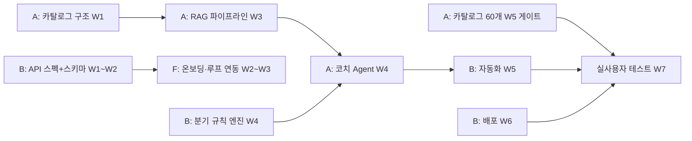

# 03. 작업 분담서 (WBS) — 꽃피다 (Bloomy)

> 3인 팀이 8주 일정에 맞춰 나눠서 작업할 분담 문서. 기획서(`01-기획서.md`)의 12절(8주 일정), 14절(3인 역할)의 실행판이다. 기존 `02-요구-명세서.md`(11/9 구현 기반 명세)는 W2에서 기획서 v0.3에 맞게 갱신한다.
>
> | 항목 | 내용 |
> |------|------|
> | 버전 | v0.1 |
> | 날짜 | 2026-11-14 |
> | 기준 문서 | `01-기획서.md` v0.3 |

## 1. 역할 정의 (3인)

| 코드 | 역할 | 담당 업무 (14절 기준) |
|------|------|----------------------|
| **B** | PM / 백엔드 | 일정·범위 관리, API·인증·DB, 배포, 테스터 모집·운영(QA), Git·문서 관리 |
| **A** | AI / 데이터 | 두 핵심 AI(커리큘럼 RAG, 코치 Agent), 프롬프트·가드레일·Memory 설계, **카탈로그 구축(전담) + 전문가 검수 조율** |
| **F** | 프론트엔드 / 콘텐츠 | 온보딩·데일리 루프·리포트·대시보드 UI, 카탈로그 구축 지원, 코칭 문장 검수 |

- 팀원 이름은 확정 후 이 표에 기재
- **B = PM**이다: 일정 관리·리스크 로그·게이트 체크는 B가 소유
- QA는 3인 모두 분담 (W7~W8 집중)

## 2. 주간 작업 분담 (W1~W8)

### W1 — 기반·진단

| 담당 | 작업 | 산출물 |
|------|------|--------|
| B | GitHub 저장소 구조·브랜칭 규칙·커밋 컨벤션 수립, DB 스키마 초안(9.3) + PostgreSQL/Neon 워크스페이스, **테스터 모집 시작(8가구 목표)** | 저장소, 스키마 초안, 모집 채널 오픈 |
| A | 카탈로그 구조 설계(7.1: 필드·단계 L1~L5·나이별 매핑) + 큐레이션 착수, 부모 인터뷰 5건 설계·실시 | 카탈로그 구조 문서, 인터뷰 노트 5건 |
| F | 화면 목록·와이어프레임(온보딩·데일리 루프·리포트·대시보드), 카탈로그 항목 초안 10개 | 와이어프레임 |

### W2 — 명세서·온보딩

| 담당 | 작업 | 산출물 |
|------|------|--------|
| B | **기능 요구 명세서 갱신**(`02-요구-명세서.md`를 기획서 v0.3에 맞게: 4~7세, 핵심 AI 2개, 카탈로그 60개, 서버리스 크론) 주도 | 요구 명세서 v2, 인증 API |
| A | 요구 명세서 AI 활용 명세(6절) 갱신, LLM API 선택 비교·확정(16절-5), 카탈로그 20개 | 요구 명세서(부분), LLM 확정 |
| F | 요구 명세서 UI 요구사항 작성, **온보딩 UI** (프로필 입력 + 5문항 체크 + 단계 진단 결과 화면) | 요구 명세서(부분), 온보딩 화면 |
| 3인 | **게이트 G1**: 요구 명세서 전체 리뷰·승인 (1회 집중 리뷰) | 요구 명세서 확정 |

### W3 — 핵심 AI ① (커리큘럼 추천, RAG)

| 담당 | 작업 | 산출물 |
|------|------|--------|
| B | DB 확정(스키마 반영 + pgvector 임베딩 컬럼), 온보딩 백엔드 API, 카탈로그 seed 스크립트 | DB, 온보딩 API |
| A | **RAG 파이프라인** (카탈로그 인덱싱, 메타데이터 필터+벡터 검색, 6.2절) + **커리큘럼 추천** (4주 계획 초안 + 학습 방법 설명, 구조화 출력) + 프롬프트 v1 | 커리큘럼 추천 동작 |
| F | 온보딩-백엔드 연동, **데일리 루프 UI** (오늘의 카드 + 30초 피드백 입력) | 온보딩 완주, 루프 UI |
| 3인 | **게이트 G2**: 커리큘럼 추천이 "입력 → 4주 계획 초안 + 학습 방법 설명(콘텐츠명 인용)"으로 완주 | 데모 1회 |

### W4 — 핵심 AI ② (코치 Agent)

| 담당 | 작업 | 산출물 |
|------|------|--------|
| B | 피드백 저장 API, **분기 판정 규칙 엔진** (5.4의 A/B/C 명시 조건 — LLM 밖에서 선판정) | 분기 엔진 |
| A | **코치 Agent** (도구 4종: catalog/rag/memory/plan.adjust, 6.3절), Case A/B/C 프롬프트 + 가드레일(6.6), Long-term Memory 스키마·쓰기 로직 | 코치 Agent v1 |
| F | 피드백 UI-백엔드 연동, **코칭 메시지 화면** (AI 생성 표기 포함) | 메시지 화면 |
| 3인 | **게이트 G3**: 카드 → 피드백 → 분기 → 코칭 메시지 + 내일 카드 1사이클 완주 | 데모 1회 |

### W5 — 자동화 + 카탈로그 게이트

| 담당 | 작업 | 산출물 |
|------|------|--------|
| B | **자동화 워크플로우** (daily 카드 발송, 미기록 리마인더 1회, 주간 리포트, 월간 결산 — 서버리스 크론, 6.5절) + 무료 티어 1회/일 제한 대응 | 자동 루프 |
| A | **카탈로그 완성: 60개 내외, 나이별(4/5/6/7) 15+** + 전문가 검수 1~2인 조율·기록 + 코칭 품질 샘플 검수(10건) | 카탈로그 확정 |
| F | **요금 인센티브 대시보드** (달성률 실시간) + 주간 리포트 화면 | 대시보드, 리포트 화면 |
| 3인 | **게이트 G4 (테스트 전제)**: 카탈로그 게이트 통과 + 자동 루프 3일 연속 무중단 | 게이트 체크리스트 |

### W6 — 배포 + 내부 검증

| 담당 | 작업 | 산출물 |
|------|------|--------|
| B | **Vercel 배포** (환경변수: DB, LLM 키, 크론 시크릿), 배포 후 모니터링, PG 결제 테스트 모드 설정, **내부 검증 1~2가구 온보딩** | **배포 URL(미션 필수)** |
| A | 실데이터 1~2가구의 코칭 메시지 품질 확인·프롬프트 보정 | 프롬프트 v2 |
| F | 모바일 퍼스트 UX 최종 점검 (30초 입력·탭 4회 이내, NFR-03) | UX 체크리스트 |
| 3인 | **게이트 G5**: 배포 URL 공개 + 내부 2가구 3일 루프 완료 → 실사용자 테스트 GO/NO-GO | GO 결정 |

### W7 — 실사용자 테스트 시작 (2주 운영, W8까지)

| 담당 | 작업 | 산출물 |
|------|------|--------|
| B | **테스터 5~8가구 온보딩 진행**, 미션 요건 체크(연속 10일+ 사용 기록), 이슈 트래킹·하루 1회 스탠드업 운영 | 테스트 로그 |
| A | 코칭 품질 일일 모니터링, 분기 판정 오탐 사례 회집, 필요 시 프롬프트·규칙 보정 | 품질 로그 |
| F | 코칭 문장 검수(매일 10건), UI 버그 수정, 카탈로그 링크 유효성 점검 | 버그 수정 기록 |

### W8 — 테스트 종료·피드백 반영·최종화

| 담당 | 작업 | 산출물 |
|------|------|--------|
| B | **피드백 정리 → 우선순위(Must/Should) → 반영 계획**, 종료 인터뷰 5건 진행(30분), **발표 자료** (문제 정의·AI 기술 의사결정·"들었던 말→바꾼 것" 대응표 3+) | 발표 자료 |
| A | AI 관련 피드백 반영 (분기 규칙·프롬프트·Memory), 코칭 품질 지표 산출 (15절) | AI 개선 사항 |
| F | UI 관련 피드백 반영, **README 최종화** (개요·역할·스택·실행 방법·테스트 결과·배포 링크), **시연 영상 촬영** | README, 시연 영상 |
| 3인 | **게이트 G6**: 피드백 반영 3건 이상 확정 + 최종 배포 + 문서 완비 | 최종 배포 |

## 3. 의존 관계 (막힘 지점)

- **A의 카탈로그 구조(W1)가 늦으면 W3 RAG가 막힌다** → W1 목요일까지 구조 확정 체크
- **B의 API 스펙이 늦으면 F가 막힌다** → B가 늦으면 F는 목업 데이터로 UI 개발 지속
- **W5 카탈로그 게이트는 테스트의 전제** (12절 W5, 7.2절)

## 4. 게이트 (Gate) 정의

| 게이트 | 시점 | 통과 기준 | 소유 |
|--------|------|-----------|------|
| G1 | W2 말 | 요구 명세서 3인 승인 | B |
| G2 | W3 말 | 커리큘럼 추천: 나이(4/5/6/7) 또는 목표 입력 → 4주 계획 + 학습 방법 설명(콘텐츠명 인용) 완주, 부모 승인 게이트 동작 | A |
| G3 | W4 말 | 데일리 루프 1사이클: 피드백 → A/B/C 분기(규칙) → 코칭 메시지(AI 표기) + 내일 카드 | A+B |
| G4 | W5 말 | **카탈로그 60개(나이별 15+) + 자동 루프 3일 연속 무중단** | A+B |
| G5 | W6 말 | 배포 URL 공개 + 내부 2가구 3일 루프 → GO/NO-GO | B |
| G6 | W8 말 | 피드백 반영 3건 + 발표 자료·README·시연 영상 완비 + 최종 배포 | 3인 |

## 5. 마일스톤별 DoD (Definition of Done)

- **기능**: 코드 + 동작 확인(데모) + 커밋(저장소) + 이슈/커밋 메시지
- **카탈로그 항목**: 필드 8종(7.1) 완비 + 신뢰 근거 기록 + (마감 전) 전문가 검수 완료
- **AI 기능**: 프롬프트 버전 기록 + 가드레일 테스트 케이스(진단 표현·카탈로그 밖 추천 차단) 통과
- **배포**: 외부 URL에서 전체 플로우(가입 → 온보딩 → 루프) 동작 확인

## 6. 소통·운영 프로토콜

| 항목 | 규칙 |
|------|------|
| 스탠드업 | 하루 1회, 비동기 문서에 3줄(오늘/내일/막힘) — W7 테스트 기간부터 강제 |
| 정기 미팅 | 주 1회 60분: 게이트 진행·리스크 리뷰 |
| 분기·브랜치 | `main`(배포) + 기능 브랜치, PR 병합 (3인이므로 PR 리뷰는 1인 이상) |
| 커밋 컨벤션 | `docs: / feat: / fix: / test:` + 한국어 본문 |
| 리스크 로그 | B가 소유, 주간 미팅에서 업데이트 (13절 리스크 기준) |
| 문서 | 저장소 루트의 numbered 파일 (01 기획서, 02 요구 명세서, 03 본 문서 …) |

## 7. 리스크별 소유 (13절 중 주요 항목)

| 리스크 | 1차 소유 | 2차 지원 |
|--------|----------|----------|
| 카탈로그 지연 (G4 위험) | A | F (카탈로그 지원이 본래 업무) |
| API 스펙 지연으로 F 대기 | B | F (목업으로 선개발) |
| 테스터 모집 부족 (미션 5명) | B | A·F (개인 네트워크) |
| 코칭 품질 편차 | A | F (문장 검수), B (테스터 피드백 채널) |
| 8주 범위 초과 | B (범위 결정) | 3인 |

## 8. 미션 산출물 → 담당 매핑

| 미션 산출물 | 문서·위치 | 주도 |
|-------------|-----------|------|
| 기획서 | `01-기획서.md` | 3인 (초안 B) |
| 기능 요구 명세서 | `02-요구-명세서.md` (W2에 기획서 v0.3 반영으로 갱신) | B 주도, A·F 부분 작성 |
| AI 서비스 (배포) | 코드 + Vercel URL | B (배포), A (AI), F (UI) |
| GitHub 버전 관리 | final 저장소 전체 | B (규칙) |
| 발표 자료 | W8 (16절 결정 사항 포함) | B |
| 사용자 피드백 반영 | 테스트 로그 + "들었던 말→바꾼 것" 표 | B (정리), A·F (반영) |
| README | 저장소 루트 (W8 최종화) | F |
